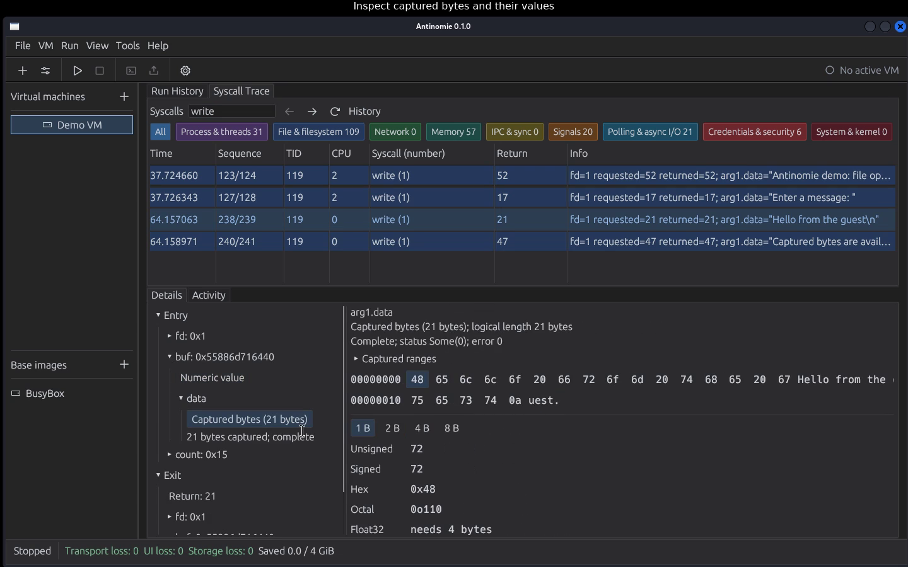

# Antinomie

Antinomie is a desktop application for watching what a program does inside a
virtual machine. You start a QEMU/KVM guest, copy a program into it, run it, and
the app records every system call the program and its child processes make,
together with the data they pass to the kernel. Recordings are saved, so you can
reopen and inspect any run later.

It is built for malware analysis and reverse engineering: run untrusted code in a
disposable guest, then read exactly which files, sockets, processes and kernel
features it touched.

## Demo

[](assets/demo/antinomie-0.1.0.mp4)

[Watch the video](assets/demo/antinomie-0.1.0.mp4): create and boot a BusyBox VM,
upload and run a harmless program, inspect syscall flags and captured bytes,
then reopen its saved trace and terminal output. Recorded with **0.1.0** on
main; pauses are trimmed. [Recording details](assets/demo/README.md).

## How it works

- **Guest kernel.** The guests run Linux 6.12.94 with a small patch that records
  system calls. The kernel itself runs your programs and terminals, so no helper
  program sits inside the guest for malware to spot or tamper with.
- **Transport.** Records reach the host over shared memory, through a buffer per
  virtual CPU. If the host cannot keep up, the loss is counted and shown, never
  hidden; in **Never drop** mode the guest waits for the host instead.
- **Host app.** A native Linux desktop application (Rust, egui) manages VMs and
  shows live and saved traces.
- **Guests.** Two base images:
  - **BusyBox**: tiny and fast to boot, good for quick tests.
  - **Debian 13 (Xfce)**: a full desktop, closer to a real target machine.

Captured data is an observation, not proof: memory can change while it is being
read, and anything the app could not decode or lost is marked as such.

## Requirements

- Linux x86-64 host (WSL2 works with an X11 display)
- QEMU (`qemu-system-x86_64`); KVM (`/dev/kvm`) strongly recommended
- Rust to build the app; building kernels and bases needs the tools listed in
  [CONTRIBUTING.md](CONTRIBUTING.md)
- Static analysis runs in a bubblewrap sandbox (`bwrap`). Disassembly, rules
  and identification are built in. Decompilation (Ghidra), capabilities
  (capa) and Detect It Easy use the system's copy when installed; otherwise
  **Tools > Analysis tools** downloads them for Antinomie

## Quick start

```bash
git clone https://github.com/MoreMorePwn/Antinomie.git ~/src/antinomie
cd ~/src/antinomie
./run.sh        # build if anything changed, then start the app
./install.sh    # or install it for this user: `antinomie` command and menu entry
                # (./install.sh --uninstall removes it; application data stays)
```

Your bases, VM disks and recordings are kept in `~/antinomie`. The app's
version is in its title bar and **Help > About Antinomie**; see
[CHANGELOG.md](CHANGELOG.md) and the versioning rules in
[CONTRIBUTING.md](CONTRIBUTING.md#12-versioning).

## Using the app

### 1. Get a base image
The **Base images** section in the left sidebar lists installed bases. Use
**Add base** to get one:
- **Download base…**: fetch a published, checksum-verified base.
- **Import base…**: install a bundle folder you already have.
- **Build base…**: build one with the app's own build kit. A short wizard asks
  installer-style questions (hostname; for Debian also language, keyboard, time
  zone, software and mirror), then builds on this Linux host when the tool suite
  is installed or inside a QEMU builder VM otherwise, and installs the result.

Bases are read-only templates. Right-click a base to make a **New VM from this
base** or to **Delete base**. Deleting is refused while any VM still uses it.

### 2. Create a VM
Choose **New VM**, pick the installed base, and set name, CPU count, RAM and
disk size. Debian bases also ask for a username and password; the guest
account is created for you. Each VM gets its own disk layered on the base, so
the base never changes.

Right-click a VM for **Rename**, **Duplicate** (the VM must be stopped),
**Open Directory**, **Settings** (resolution, fullscreen or fit to window,
acceleration, CPU model) and **Delete**.

**Settings → Telemetry transport…** tunes how records leave the guest (bases
for Antinomie 0.3.0 and newer):

| Setting | Effect |
|---|---|
| Guest buffer per vCPU | 256 KiB to 4 MiB of guest memory per virtual CPU (default 1 MiB); bigger buffers ride out longer bursts |
| When buffers fill | **Never drop** (default): a system call waits until the host has room, so heavy tracing slows the guest but nothing is lost; or **Drop new telemetry**: the guest never waits (keeps its timing) and the loss is counted |
| Longest wait per event | In Never drop mode, how long one call may wait (default 5 s) before its record is dropped after all |
| Host event table | How many calls the host keeps assembling at once (default 16,384) |

### 3. Start it and run a program
1. Select the VM and press **Start VM**. Only one VM runs at a time, and its
   network is disconnected by default.
2. **Upload file** copies a program from the host (**Host file**) to a path in
   the guest (**Guest path**).
3. **Launch program** runs it. Set the **Executable**, **Arguments**,
   **Working directory** and **Environment**. Each launch gets its own terminal
   window for input and output.
   On a VM with a desktop base, **Run in** picks where the program runs:
   **App terminal** (the default), **Guest desktop** (the program joins the
   graphical session, so its windows appear on the VM screen; its output
   stays in the app terminal) or **Guest desktop terminal** (a terminal
   window on the VM screen runs it). Both desktop choices need the run's user
   logged in on the VM display; otherwise the app terminal says so.
4. **Stop** ends a run together with all of its child processes. Closing a
   terminal window does not stop the program.
5. **Static Analysis** in the launch dialog analyzes the program's file before
   it runs; pick the categories, from triage to disassembly and decompilation.
6. **Attach to process** traces a process that is already running in the guest
   (and its future children); **Capture all** traces all of userspace. Neither
   stops or signals anything. A capture lists the processes it saw as a tree
   (named after the program each one ran); select one to see only its calls.
7. With **NAT network** on, every packet of the VM's network interface is
   recorded by QEMU, outside the guest, as `network.pcap` in the boot's
   recording.

### 4. Read the results
- **Syscall Trace**: every recorded call with its arguments, return value and
  captured data. Flags and options are decoded into names (for example
  `O_CREAT | O_CLOEXEC`, `SOL_SOCKET / SO_RCVBUF`, `PR_SET_NAME`), unknown bits
  are listed separately, and captured buffers can be inspected byte by byte.
- **Run History**: every run on the selected VM, including earlier boots, with
  its command line, user, status and exit code. Double-click a run to open its
  saved trace.
- **Network**: the packets of the running boot (followed live) or an earlier
  one: source, destination, protocol and a summary (DNS names and answers, TCP
  flags, HTTP request lines, TLS server names), with the bytes of the selected
  packet. **Open in Wireshark** hands the capture to Wireshark when it is
  installed.
- **Static Analysis**: the selected run's report: an overview, then each
  category; disassembly and decompilation are full listings with search.
- **Details** and **Activity**: the selected call or run, and VM events.

Panels can be dragged out into their own windows and docked back;
**View → Reset layout** restores the default arrangement. Text size is under
**Tools → Settings**.

## Development

Kernel changes, the patch workflow, building kernels and base images, and the
test suites are described in [CONTRIBUTING.md](CONTRIBUTING.md) and
[MONITOR-IMPLEMENTATION.md](MONITOR-IMPLEMENTATION.md). Coding agents follow
[AGENTS.md](AGENTS.md).

## License

Original Antinomie host and tooling code is [MIT licensed](LICENSE), copyright
2026 MikiMiku (MoreMorePwn). Kernel-derived and imported material keep their own
terms. Read the [licensing scope](LICENSING.md) and
[third-party notices](THIRD-PARTY-NOTICES.md) before redistributing; the kernel
and guest images as a whole are not MIT licensed.
