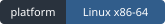
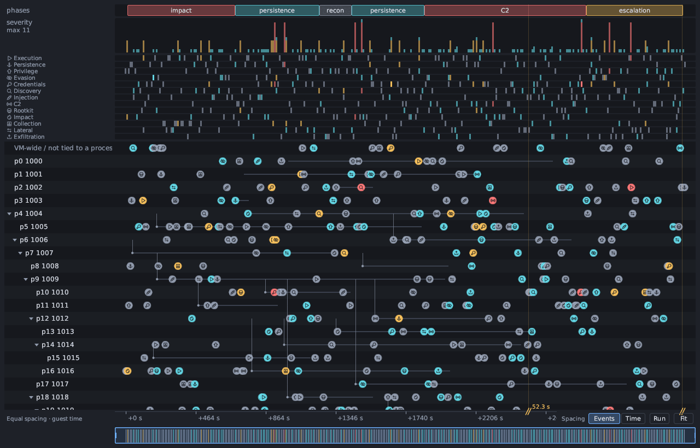

<div align="center">

<picture>
  <source media="(prefers-color-scheme: dark)" srcset="assets/branding/antinomie-logo-dark.svg">
  
</picture>

# Antinomie

**Watch Linux malware from below the kernel line.**

Antinomie runs Linux samples in disposable QEMU virtual machines on your own
computer and observes them from inside the guest kernel. No agent runs in the
guest and nothing uses `ptrace`, so a sample has little to find. Process, file,
network, memory, disk and core evidence, static analysis, a debugger and Triage
all work from one saved recording.

[**Quick start**](#quick-start) ·
[User guide](docs/usage.md) ·
[Releases](https://github.com/MoreMorePwn/Antinomie/releases) ·
[Changelog](CHANGELOG.md) ·
[Roadmap](#roadmap) ·
[Contributing](CONTRIBUTING.md)

[](https://github.com/MoreMorePwn/Antinomie/actions/workflows/ci.yml)
[](#requirements)
[](docs/implementation.md)
[](LICENSING.md)

<br>



<sub>The activity graph in Triage. This frame is the graph's own test fixture
with <b>synthetic data</b>, not a recorded malware run.</sub>

</div>

> [!WARNING]
> **Antinomie runs real malware when you ask it to.** The sample executes inside
> a QEMU guest. A VM is a strong boundary, not an absolute one: guest-to-host
> escapes are rare but possible, and a sample you give network access can reach
> whatever that route reaches. Use a dedicated machine, or at least a user
> account with nothing valuable, keep VM networking disconnected unless you need
> it, and prefer the **None (drop)** or **InetSim** routes. Run unknown files
> only on a computer you can rebuild. Detections are leads to investigate, not a
> verdict that a file is or is not malicious.

> [!NOTE]
> This README describes **0.7.1**, the first release since 0.6.2 (0.7.0 was not
> published separately). Download it from
> [Releases](https://github.com/MoreMorePwn/Antinomie/releases); the
> [changelog](CHANGELOG.md) lists every change.

## Highlights

<table>
<tr>
<td width="33%" valign="top">

**A sandbox at kernel level**

Samples run in disposable QEMU VMs on your own machine. A patched Linux 6.12.94
guest kernel does the observing, so no agent runs in the guest.

</td>
<td width="33%" valign="top">

**No `ptrace` in the guest**

The kernel debugger uses no `ptrace` either: `TracerPid` stays 0 and the
sample's own `PTRACE_TRACEME` succeeds.

</td>
<td width="33%" valign="top">

**Evidence stays honest**

Unreadable bytes, unsupported information and recording gaps stay visible.
Losses are counted, never hidden.

</td>
</tr>
<tr>
<td valign="top">

**One workspace**

Trace, Triage, network, memory, static analysis and a debugger share one saved
recording. No exporting between tools.

</td>
<td valign="top">

**Reopen any run**

Runs are saved. Open them from **Run History** long after the VM is gone.

</td>
<td valign="top">

**Native and local**

A Rust and egui desktop app on your own machine. Analysis tools run in a
bubblewrap sandbox, and nothing downloads until you ask.

</td>
</tr>
</table>

## What you can investigate

| Workspace | What it gives you |
|---|---|
| **VM management** | Read-only bases, per-VM disks, branching snapshots, resource monitoring, stealth profiles and a stopped-VM disk browser. |
| **Triage** | Process trees, per-file history, suspicious activity with an activity graph, HTTP/DNS/TLS metadata and detection results. |
| **Network** | Saved PCAPs, TShark decoding with Wireshark display filters, and per-run routes: drop, Internet, InetSim, Tor, WireGuard or SOCKS5, without root. |
| **Memory and cores** | Capture memory and process cores, browse mappings, and analyze dumps with Volatility 3 or MemNixFS. |
| **Static analysis** | Hashes, strings (FLOSS), UPX unpacking, capa, disassembly and Ghidra decompilation. |
| **Debugger** | Debug on start or attach: threads, registers, memory, breakpoints, stepping, and GDB with GEF or pwndbg. |
| **Syscall trace** | Kernel-recorded system calls with arguments, return values, decoded flags and captured buffers, with filters and links to evidence. |
| **Detection rules** | Community and custom YARA, Suricata and Sigma collections, plus abuse.ch indicator datasets. |

Optional engines are installed from **Tools → Analysis tools** or provided by
the host. See the [tool requirements](docs/usage.md#dependencies-and-analysis-tools).

## How it works

```text
Program and descendants in the guest
                ↓
      Patched Linux guest kernel
                ↓
       Shared-memory transport
                ↓
   Native host app → saved recordings
                ↓
  Trace · Triage · Network · Analysis
```

The host manages the VM, keeps the records and presents the evidence. Memory and
captured data can change while observed, so unreadable bytes and gaps stay
visible. Transport buffering is configurable: **Never drop** waits for host
capacity up to a deadline, **Drop new telemetry** keeps the guest running and
counts what is lost. Details are in the
[implementation notes](docs/implementation.md).

## Quick start

### Install a published build

You need Linux x86-64 with glibc 2.39 or newer (Debian 13, Ubuntu 24.04 or
later). On Debian or Ubuntu, install the host programs:

```sh
sudo apt install qemu-system-x86 qemu-utils qemu-system-gui bubblewrap tshark util-linux
```

Download the Linux archive and `SHA256SUMS` from
[Releases](https://github.com/MoreMorePwn/Antinomie/releases), then verify,
extract and install for your user (no root):

```sh
sha256sum --check SHA256SUMS
./install.sh      # run inside the extracted folder
antinomie
```

Prebuilt installs do not need Rust. Running `./install.sh` from a newer release
updates the executable and keeps your data; `./install.sh --uninstall` removes
the three installed files and keeps your data too. Only Debian and Ubuntu
package names have been checked; other distributions are not documented.

<details>
<summary><b>Run from source</b></summary>

<br>

Install the [host build prerequisites](src/antinomie/monitor/README.md#build-and-run), then:

```sh
git clone --branch v0.7.1 https://github.com/MoreMorePwn/Antinomie.git
cd Antinomie
./run.sh
```

`run.sh` rebuilds when its inputs change, then starts the app. `./install.sh` in
the checkout builds and installs it for your user. Building the host app does
not build a guest kernel or base image.

</details>

<details>
<summary><b>Offline install: build your own full pack</b></summary>

<br>

Optional tools (Ghidra, capa, FLOSS, Volatility 3, MemNixFS, Tor and others) are
normally downloaded the first time you ask. For a computer that must not
download anything, **you build a full pack** on a connected machine with
`scripts/build-full-pack.py`. It fetches the same pinned, SHA-256-verified tools
from their upstream hosts. Copy it over, extract it and run
`./install-full-pack.sh`. **Antinomie does not publish a pack.** See
[docs/full-pack.md](docs/full-pack.md).

</details>

### Make your first recording

1. Open **Base images** and download, import or build a compatible base.
2. Create a **New VM** from that base, choose its resources and start it.
3. Upload your sample and launch it. Enable the captures you need; network
   recording requires a connected guest network.
4. Inspect the live views, then reopen the saved run from **Run History**.

<div align="center">

<br>
<sub>First launch on an empty data directory: the Getting started guide.</sub>
</div>

#### Choose a base

| Base | Best for | Notes |
|---|---|---|
| **BusyBox** | Command-line samples | Small and fast to boot. |
| **Debian 13 Minimal (console)** | Samples that need a real Debian userspace without a desktop | APT and the standard command-line tools, no desktop. Needs at least 1024 MiB RAM and 4 GiB disk. New in 0.7.1. |
| **Debian 13 (desktop)** | Samples that need a graphical session | Adds the desktop; programs can run in the guest desktop. |

Choose a base compatible with the application. Installing a newer app does not
replace an existing VM's pinned base. Your data (bases, VM disks, recordings)
lives in `~/antinomie` by default. The [user guide](docs/usage.md) covers
controls, transport settings, desktop execution and layouts.

## Requirements

| Need | Details |
|---|---|
| **Host** | Linux x86-64 with a graphical session. WSL2 needs a working graphical display, and KVM access depends on its virtualization setup. |
| **Virtualization** | QEMU (`qemu-system-x86_64`, `qemu-img`) with the GTK display backend. KVM is strongly recommended; TCG works without it but is not performance-qualified. |
| **Analysis** | bubblewrap for isolation; TShark and `prlimit` for packet decoding and filters. Other tools depend on the analysis you choose. |
| **Debian VMs** | `virt-customize` (`libguestfs-tools`) to create one. |

The app checks dependencies at startup (**Tools → App dependencies**). From a
terminal: `antinomie --check-dependencies`. The
[full dependency list](docs/usage.md#dependencies-and-analysis-tools) names every tool.

## Limits

* **Stealth is bounded.** A stealth profile changes what a guest can read of its
  hardware identity, and the kernel hides its own traces, but some things stay
  visible (the app lists them under "Still visible"). `CPUID` and `RDTSC` checks
  leave no system call and are not seen. A sample that reads its own code can
  find the debugger's `0xCC` breakpoint bytes; hardware breakpoints avoid that.
  Do not assume a sample cannot tell it is being analyzed.
* **Telemetry can be lost.** Very heavy load can drop telemetry, and reconnects can
  be slow. Loss and partial-recording indicators stay on, and
  [telemetry robustness](#roadmap) is planned.
* **Linux x86-64 only.** Guests and the host are x86-64 Linux today.
* **Tools are optional and pinned.** Engines run only if installed; downloads are
  checked against SHA-256 values recorded in the source.

## What's in 0.7.1

Highlights of 0.7.1 on top of the 0.7.0 work; the [changelog](CHANGELOG.md) has
the full list.

<details>
<summary><b>Show the 0.7.1 changes</b></summary>

<br>

* **Debian 13 Minimal base:** a console-only Debian beside BusyBox and the
  desktop base, with rootless Debian image builds, laid out and configured as
  the Debian installer leaves it (per-VM identities, installer timestamps,
  Debian's own kernel packages in `/boot`, natively hashed accounts) and
  bootable on virtio, SATA and NVMe.
* **Static analysis:** Strings and Regex matches as separate tabs.
* **Kernel patch series** rewritten as fourteen documented topic patches.
* **Network routes:** a route per run (drop, Internet, InetSim, Tor, WireGuard via
  wireproxy, SOCKS5) without root, with `tor` and `wireproxy` as managed tools.
* **File activity:** a per-file history with the processes and writes, and an
  analysis tree in Run History.
* **Activity graph:** equal spacing by default with a Time toggle, an overview
  ruler, category icons and a legend.
* **MemNixFS** as a second memory backend for Linux dumps.
* **abuse.ch IOC datasets** for offline indicator matching, on abuse.ch's v2
  export endpoints.
* **eBPF findings** for programs attached through `BPF_LINK_CREATE`, raw
  tracepoints and perf events.
* **Stealth fallback warnings** when a profile asks for more than a base offers.
* **Full-pack builder** to make your own offline bundle of the managed tools.
* **Reliability:** bounded waits for report writes and host file copies, pending
  analyses that settle on their own, and many test-timing fixes.

</details>

## Roadmap

**Planned, not built, and undated.** Nothing below is in 0.7.0 or 0.7.1.

**0.8.0 candidates**

| Area | Idea |
|---|---|
| Automation | **Rule-triggered actions**: syscall "what if" triggers; **auto mode**: ELF in, report out; whole-Triage report export; a headless, API and web mode |
| Capture | **TLS decryption**; **file write-content capture**; **per-packet process attribution** |
| Depth | **MMU-level unpacking** and fileless capture; **root-level activity** (rootkits, LKMs, eBPF) |
| Reach | **arm64 and RISC-V guests** |
| Quality | **Telemetry robustness** (drops under heavy load, reconnect speed) |

## Documentation

| Read | For |
|---|---|
| [User guide](docs/usage.md) | Bases, VMs, runs, routes and reading results. |
| [Triage report](docs/triage-report.md) | Export formats, evidence bundle and the JSON schema. |
| [Implementation contract](docs/implementation.md) | Supported behavior, wire contracts, measurements and limits. |
| [Host build guide](src/antinomie/monitor/README.md) | Native monitor builds and development commands. |
| [Contributing](CONTRIBUTING.md) | Kernel patch workflow, builds, checks and version branches. |
| [Conformance suite](tests/monitor/conformance/README.md) | Disposable-VM checks and the recording oracle. |
| [Project layout](docs/project-layout.md) | Durable source, build outputs and artifact retention. |
| [Full pack](docs/full-pack.md) | Build your own offline bundle of every managed tool. |

<details>
<summary><b>Testing: workload samples and the conformance suite</b></summary>

<br>

The **workload test samples** are controlled generators of system-call load,
process trees, file activity, network traffic, async I/O, unusual arguments,
crash handling and detection markers. `ant-workload` combines the modules;
individual `ant-*` programs isolate one feature at several load levels.
A sample's `PASS` means its action ran. The separate **conformance suite**
checks what Antinomie recorded: arguments, results, captured bytes, identities,
loss accounting and trace rendering. Build the samples with
[`build-workload.sh`](tests/monitor/build-workload.sh).

</details>

## Contributing

Contributions to the host application, tooling and documentation are welcome and
accepted under GPL-3.0-only. Read [CONTRIBUTING.md](CONTRIBUTING.md) first: it
covers the kernel patch workflow, the checks and the `release-X.Y.Z` branch rule.
Run `python3 scripts/check-module-size.py` and `scripts/check-privacy.sh` before
sending changes.

## License

Original host application, tooling and product documentation use
**[GPL-3.0-only](LICENSE) from 0.7.0**. Earlier releases keep their original MIT
terms. Shared kernel headers remain MIT; kernel-derived code, guest components,
third-party tools, rules and assets keep their own licenses.

Read [LICENSING.md](LICENSING.md), the [third-party notices](THIRD-PARTY-NOTICES.md)
and the [dependency notice inventory](docs/license-inventory.md) for the scope and
redistribution requirements.

## Acknowledgements

Antinomie builds on the Linux kernel and Debian's kernel sources, QEMU, and the
Rust ecosystem (egui, YARA-X and many crates, listed with their licenses in the
notices). The tools it can run or install belong to their authors: Ghidra, capa
and FLOSS (Mandiant), Detect It Easy, UPX, Volatility 3, MemNixFS, pySigma,
Magika (Google), GEF (bata24), pwndbg, Tor, wireproxy, Wireshark/TShark and
Suricata. Community rules come from their publishers, such as YARA Forge,
Emerging Threats and abuse.ch, under the licenses each carries. Exact versions,
hashes and terms are in [THIRD-PARTY-NOTICES.md](THIRD-PARTY-NOTICES.md).

## Trademarks

Dell, OptiPlex, Latitude, PowerEdge, HP, EliteDesk, ProDesk, ProBook, Lenovo,
ThinkCentre, ThinkPad, ThinkSystem, Supermicro, Intel, AMD, Realtek, Broadcom,
Samsung and other names in the stealth machine catalog and the documentation
belong to their owners. Antinomie uses them only as factual identifiers (the
model, BIOS version and device names a real unit reports, so a guest looks like
one). It contains no logos, firmware images, dumped ACPI tables or real serial
numbers, and is not affiliated with, endorsed by or sponsored by any of them.
