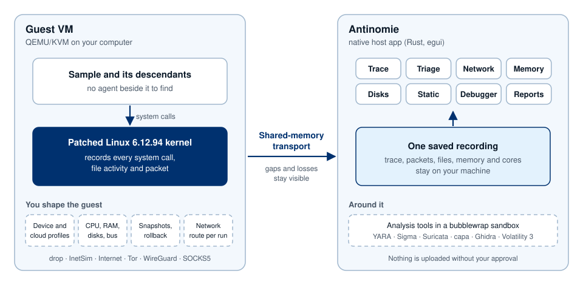

<div align="center">

<picture>
  <source media="(prefers-color-scheme: dark)" srcset="assets/branding/antinomie-logo-dark.svg">
  
</picture>

### A local, kernel-level Linux malware analysis sandbox and workspace.

Run a Linux sample in a disposable VM on your own computer, watch it from inside
the guest kernel, and investigate everything it did in one desktop app.

**Local**: samples, recordings and analysis stay on your machine; nothing is uploaded without your approval.<br>
**Kernel-level**: the guest kernel records every system call, file activity and packet; no agent to find.<br>
**Sandbox**: QEMU VMs you control down to the hardware: CPU, memory, disks and their bus, real device and cloud identities, branching snapshots you can reset or roll back to, and a network route per run.<br>
**Workspace**: trace, Triage, network, memory, disks, static analysis, a debugger and all the tools you need in one space.

[**Quick start**](#quick-start) ·
[User guide](docs/usage.md) ·
[Releases](https://github.com/MoreMorePwn/Antinomie/releases) ·
[Changelog](CHANGELOG.md) ·
[Security model](docs/security.md) ·
[Reporting vulnerabilities](SECURITY.md) ·
[Contributing](CONTRIBUTING.md)

[](https://github.com/MoreMorePwn/Antinomie/actions/workflows/ci.yml)
[](https://github.com/MoreMorePwn/Antinomie/releases/latest)
[](LICENSING.md)
[](https://antinomie.moremorepwn.blog/docs/)

<br>


<sub>Run History in the Antinomie window. This frame is a UI test fixture with
<b>synthetic data</b>, not a recorded malware run.</sub>

</div>

> [!WARNING]
> **Antinomie runs real malware when you ask it to.** The sample executes inside
> a QEMU guest. A VM is a strong boundary, not an absolute one: guest-to-host
> escapes are rare but possible.
>
> - Use a dedicated machine, or at least a user account with nothing valuable.
>   Run unknown files only on a computer you can rebuild.
> - Keep VM networking disconnected unless you need it, and prefer the
>   **None (drop)** or **InetSim** routes. A sample you give network access can
>   reach whatever that route reaches; **NAT** reaches the host's own network
>   services and your LAN.
> - Detections are leads to investigate, not a verdict that a file is or is not
>   malicious.
>
> The [security model](docs/security.md) explains the boundaries and what a
> sample can still do.

> [!NOTE]
> This is the **0.8.0 development branch**. The latest release is **0.7.1**:
> download it from [Releases](https://github.com/MoreMorePwn/Antinomie/releases)
> and read its README on the `main` branch. Sections below that describe 0.7.1
> say so; the [changelog](CHANGELOG.md) lists what 0.8.0 adds so far.

## Highlights

<table>
<tr>
<td width="33%" valign="top">

**A sandbox at kernel level**

Samples run in QEMU VMs on your own machine. A patched guest kernel observes
and controls them, so nothing runs beside the sample for it to find.

</td>
<td width="33%" valign="top">

**One workspace**

Trace, Triage, network, memory and static analysis share one saved recording,
and the debugger sits beside them on the live VM. No exporting between tools.

</td>
<td width="33%" valign="top">

**Native and local**

A Rust and egui desktop app on your own machine. Analysis tools run in a
bubblewrap sandbox. Tools and bases download only when you ask.

</td>
</tr>
<tr>
<td valign="top">

**Triage and detections**

Process tree, files, network and suspicious activity on an activity graph,
mapped to ATT&CK and matched against YARA, Sigma, Suricata and abuse.ch
indicators.

</td>
<td valign="top">

**Report export**

Save a run as HTML, PDF, JSON, MISP or STIX 2.1, with an optional evidence
bundle of its captures and dropped files.

</td>
<td valign="top">

**Every system call**

Decoded arguments, flags, return values and captured buffers, searchable with
a filter language and linked to the evidence they produced.

</td>
</tr>
</table>

## What you can investigate

| Workspace | What it gives you |
|---|---|
| **VM management** | Read-only bases, per-VM disks, branching snapshots, resource monitoring, device profiles and a stopped-VM disk browser. |
| **Triage** | Process trees, per-file history, suspicious activity with an activity graph, HTTP/DNS/TLS metadata and detection results. |
| **Network** | Saved PCAPs, TShark decoding with Wireshark display filters, and per-run routes: drop, Internet, InetSim, Tor, WireGuard or SOCKS5. |
| **Memory and cores** | Capture memory and process cores, browse mappings, and analyze dumps with Volatility 3 or MemNixFS. |
| **Static analysis** | Hashes, strings (FLOSS), UPX unpacking, capa, disassembly and Ghidra decompilation. |
| **Debugger** | Debug on start or attach: threads, registers, memory, breakpoints, stepping, and GDB with GEF or pwndbg. |
| **Syscall trace** | Kernel-recorded system calls with arguments, return values, decoded flags and captured buffers, with filters and links to evidence. |
| **Detection rules** | Community and custom YARA, Suricata and Sigma collections, plus abuse.ch indicator datasets. |
| **Sample library** | Every sample with its hashes, tags, notes, runs and artifacts, and a tamper-evident custody log of everything done to or by it. |
| **File reconstruction** | Replay a file's reads, writes and resizes from the recording to see what each byte is, with the earlier bytes a write replaced and a diff for text files. |
| **Cloud and device identities** | Guests that look like a real desktop, laptop, server or cloud VPS (Tencent, Alibaba, DigitalOcean, Vultr), with a local metadata service that hands out canary credentials. |

Optional engines are installed from **Tools → Analysis tools** or provided by
the host. See the [tool requirements](docs/usage.md#dependencies-and-analysis-tools).

## How it works

<picture>
  <source media="(prefers-color-scheme: dark)" srcset="assets/diagrams/how-it-works-dark.svg">
  
</picture>

- The host manages the VM, keeps the records and presents the evidence.
- Memory and captured data can change while observed, so unreadable bytes and
  gaps stay visible.
- Transport buffering is configurable. **Never drop** waits for host capacity up
  to a deadline; **Drop new telemetry** keeps the guest running and counts what
  is lost.

Details are in the [implementation record](docs/implementation.md).

## Quick start

### Install a published build

You need Linux x86-64 with glibc 2.39 or newer (Debian 13, Ubuntu 24.04 or
later). On Debian or Ubuntu, install the host programs. `libguestfs-tools`
gives Antinomie `guestfish`, which writes each Debian VM's account, disk layout
and network card into its disk without root; BusyBox VMs do not need it:

```sh
sudo apt install qemu-system-x86 qemu-utils qemu-system-gui curl libsqlite3-0 bubblewrap tshark util-linux libguestfs-tools
```

Download `antinomie-0.7.1-linux-x86_64.tar.gz` and `SHA256SUMS` from
[Releases](https://github.com/MoreMorePwn/Antinomie/releases) into one folder,
then verify, extract and install for your user (no root):

```sh
sha256sum --check SHA256SUMS
tar -xzf antinomie-0.7.1-linux-x86_64.tar.gz
cd antinomie-0.7.1
./install.sh
antinomie --check-dependencies
antinomie
```

- **No Rust needed.** Prebuilt installs run as they are.
- **Updating:** run `./install.sh` from a newer release. It replaces the
  executable and keeps your data.
- **Uninstalling:** `./install.sh --uninstall` removes the three installed files
  and keeps your data too.
- **Other distributions:** **Tools → App dependencies** names the packages for
  apt, dnf, pacman and zypper. Only Debian and Ubuntu installs are tested.
- **Provenance:** releases after 0.7.1 carry a build attestation. With the GitHub
  CLI, `gh attestation verify antinomie-X.Y.Z-linux-x86_64.tar.gz --repo
  MoreMorePwn/Antinomie` confirms the archive was built by this repository's
  release workflow from the tagged commit.

<details>
<summary><b>Run from source</b></summary>

<br>

Install the [host build prerequisites](src/antinomie/monitor/README.md#build-and-run), then:

```sh
git clone --branch v0.7.1 https://github.com/MoreMorePwn/Antinomie.git
cd Antinomie
./run.sh
```

`run.sh` rebuilds when its inputs change, then starts the app. `./install.sh` in
the checkout builds and installs it for your user. Building the host app does
not build a guest kernel or base image.

</details>

<details>
<summary><b>Offline install: build your own full pack</b></summary>

<br>

Optional tools (Ghidra, capa, FLOSS, Volatility 3, MemNixFS, Tor and others) are
normally downloaded the first time you ask. For a computer that must not
download anything, **you build a full pack** yourself:

1. On a connected machine, run `scripts/build-full-pack.py`. It fetches the same
   pinned, SHA-256-verified tools from their upstream hosts.
2. Copy the pack over, extract it and run `./install-full-pack.sh`.

**Antinomie does not publish a pack.** See [docs/full-pack.md](docs/full-pack.md).

</details>

### Make your first recording

1. Open **Base images** and download, import or build a compatible base.
2. Create a **New VM** from that base, choose its resources and start it.
3. Upload your sample and launch it. Enable the captures you need; network
   recording requires a connected guest network.
4. Inspect the live views, then reopen the saved run from **Run History**.

<div align="center">

<br>
<sub>First launch on an empty data directory: the Getting started guide.</sub>
</div>

#### Choose a base

| Base | Best for | Notes |
|---|---|---|
| **BusyBox** | Command-line samples | Small and fast to boot. |
| **Debian 13 Minimal (console)** | Samples that need a real Debian userspace without a desktop | APT and the standard command-line tools, no desktop. Needs at least 1024 MiB RAM and 4 GiB disk. |
| **Debian 13 (desktop)** | Samples that need a graphical session | Adds the desktop; programs can run in the guest desktop. |

- Choose a base compatible with the application. Installing a newer app does not
  replace an existing VM's pinned base.
- Your data (bases, VM disks, recordings) lives in `~/antinomie` by default.
- Downloaded bases are GPL-2.0 and Debian software: their corresponding source
  (kernel patch series and configuration, BusyBox and package sources) is in the
  `sources/` folder of the [base bucket](https://huggingface.co/buckets/MoreMorePwn/antinomie-bases/tree/main/sources).
- The [user guide](docs/usage.md) covers controls, transport settings, desktop
  execution and layouts.

<details>
<summary><b>Build your own base</b></summary>

<br>

**Base images → Add base → Build base…** builds BusyBox, Debian 13 Minimal or
Debian 13 desktop from the build kit the app carries. A short wizard asks the
installer questions (hostname; for Debian also language, keyboard, time zone,
software and mirror). **Where** picks how it builds; **Automatic** takes the
first method that can run, in this order:

<details>
<summary>Native (this Linux host)</summary>

<br>

Fastest. BusyBox builds natively on any distribution. The Debian bases also
need `mmdebstrap` and a subordinate UID range for your user. Their kernel
(Debian Minimal's and the desktop's) must carry Debian's own build string and
configuration so that Debian's signed modules load, so it is compiled with
Debian 13's gcc-14 14.2.0-19 and binutils 2.44: the host's where they are
those, else in a rootless Debian 13 toolchain chroot the build sets up once.
Install the tool suite the wizard lists, then choose **Native**.

</details>

<details>
<summary>Podman or Docker (pinned container)</summary>

<br>

Works on any distribution. The first build makes the `antinomie-builder` image
(Debian 13 pinned by digest and package snapshot, the exact toolchain) and
needs the network once; later builds start at once and leave no container
behind. Rootless Podman is preferred: Docker's group gives root-equivalent
access. Kept images are listed in the dialog with a **Remove** button.

</details>

<details>
<summary>QEMU builder (a builder VM)</summary>

<br>

Needs only QEMU and `curl`. The build runs inside a throwaway builder VM, so it
is the slowest but needs nothing else on the host. Automatic falls back to it
when no container image can be fetched.

</details>

<details>
<summary>From the command line</summary>

<br>

`scripts/build-base.py` is the same kit without the app. Write a job file
(`{"format": 1, "profile": "busybox"}`; profiles are `busybox`,
`debian-minimal` and `debian-xfce`), then:

```sh
scripts/build-base.py --job job.json --inputs INPUTS --work WORK --output OUT \
  --kernel-cache kernel.cache --image-cache image.cache --ccache ccache/ \
  --container auto
```

`--kernel-cache`, `--image-cache` and `--ccache` reuse an earlier kernel, root
filesystem and compiler output, so a rebuild after a small change takes minutes.
Import the output folder with **Add base → Import base…**.

</details>

</details>

## Requirements

| Need | Details |
|---|---|
| **Host** | Linux x86-64, glibc 2.39 or newer, with a graphical session. Tested on Debian 13 and Ubuntu 24.04. WSL2 works with an X11 display; KVM access depends on its virtualization setup. |
| **Virtualization** | QEMU 6.0 or newer (`qemu-system-x86_64`, `qemu-img`) with the GTK display backend; Routed networks (cloud profiles' metadata service) need QEMU 7.2. KVM is strongly recommended; TCG works without it but is not performance-qualified. |
| **Downloads** | `curl` for bases, rules and analysis tools. |
| **Analysis** | bubblewrap for isolation; TShark and `prlimit` for packet decoding and filters. Other tools depend on the analysis you choose. |
| **Debian VMs** | `guestfish` (`libguestfs-tools`) to create and reset them. |

The app checks dependencies at startup (**Tools → App dependencies**). From a
terminal: `antinomie --check-dependencies`. The
[full dependency list](docs/usage.md#dependencies-and-analysis-tools) names every tool.

## What's in 0.7.1

Highlights of 0.7.1 on top of the 0.7.0 work; the [changelog](CHANGELOG.md) has
the full list.

<details>
<summary><b>Show the 0.7.1 changes</b></summary>

<br>

* **Debian 13 Minimal base:** a console-only Debian beside BusyBox and the
  desktop base, with rootless Debian image builds, laid out and configured as
  the Debian installer leaves it (per-VM identities, installer timestamps,
  Debian's own kernel packages in `/boot`, natively hashed accounts) and
  bootable on virtio, SATA and NVMe.
* **Static analysis:** Strings and Regex matches as separate tabs.
* **Kernel patch series** rewritten as fourteen documented topic patches.
* **Network routes:** a route per run (drop, Internet, InetSim, Tor, WireGuard via
  wireproxy, SOCKS5) without root, with `tor` and `wireproxy` as managed tools.
* **File activity:** a per-file history with the processes and writes, and an
  analysis tree in Run History.
* **Activity graph:** equal spacing by default with a Time toggle, an overview
  ruler, category icons and a legend.
* **MemNixFS** as a second memory backend for Linux dumps.
* **abuse.ch IOC datasets** for offline indicator matching, on abuse.ch's v2
  export endpoints.
* **eBPF findings** for programs attached through `BPF_LINK_CREATE`, raw
  tracepoints and perf events.
* **Device profile fallback warnings** when a profile asks for more than a base offers.
* **Full-pack builder** to make your own offline bundle of the managed tools.
* **Reliability:** bounded waits for report writes and host file copies, pending
  analyses that settle on their own, and many test-timing fixes.

</details>

## Roadmap

Planned and undated:

- **Headless mode**
- **Docker-based web interface and API**
- **Auto mode**: a sample in, a report out
- **arm64** and **RISC-V** guests
- **TLS decryption**
- **In-memory unpacking detection**: catch and save code a sample decrypts or
  unpacks in memory
- **OpenWrt** and **Ubuntu** bases

## Documentation

| Read | For |
|---|---|
| [User guide](docs/usage.md) | Bases, VMs, runs, routes and reading results. |
| [Triage report](docs/triage-report.md) | Export formats, evidence bundle and the JSON schema. |
| [Security model](docs/security.md) | Trust boundaries, network modes, sensitive data and safe use. |
| [Security policy](SECURITY.md) | Supported versions and how to report a vulnerability privately. |
| [Implementation record](docs/implementation.md) | Implemented behavior, wire contracts, measurements and limits, by release. |
| [Host build guide](src/antinomie/monitor/README.md) | Native monitor builds and development commands. |
| [Contributing](CONTRIBUTING.md) | Host builds, checks, pull requests, the kernel patch workflow and version branches. |
| [Conformance suite](tests/monitor/conformance/README.md) | Disposable-VM checks and the recording oracle. |
| [Project layout](docs/project-layout.md) | Durable source, build outputs and artifact retention. |
| [Full pack](docs/full-pack.md) | Build your own offline bundle of every managed tool. |

<details>
<summary><b>Testing: workload samples and the conformance suite</b></summary>

<br>

- The **workload test samples** are controlled generators of system-call load,
  process trees, file activity, network traffic, async I/O, unusual arguments,
  crash handling and detection markers. `ant-workload` combines the modules;
  individual `ant-*` programs isolate one feature at several load levels. A
  sample's `PASS` means its action ran.
- The separate **conformance suite** checks what Antinomie recorded: arguments,
  results, captured bytes, identities, loss accounting and trace rendering.

Build the samples with [`build-workload.sh`](tests/monitor/build-workload.sh).

</details>

## Contributing

Contributions to the host application, tooling and documentation are welcome and
accepted under GPL-3.0-only.

- Read [CONTRIBUTING.md](CONTRIBUTING.md) first: host builds, the checks to run,
  pull requests, the kernel patch workflow and the `release-X.Y.Z` branch rule.
- Report bugs with the issue forms.
- Report security problems privately as described in [SECURITY.md](SECURITY.md).
- Never attach live malware or real credentials to a public issue.

## Responsible use

Antinomie is for analyzing software you are permitted to handle, on systems you
control.

- You are responsible for what your samples do, including any traffic they send
  through a route you enable (Internet, Tor, WireGuard or SOCKS5) and any data
  they reach.
- Device profiles present hardware identities of real vendors only to the guest;
  they imply no affiliation with those vendors.

## License

Original host application, tooling and product documentation use
**[GPL-3.0-only](LICENSE) from 0.7.0**. Earlier releases keep their original MIT
terms. Shared kernel headers remain MIT; kernel-derived code, guest components,
third-party tools, rules and assets keep their own licenses.

Read [LICENSING.md](LICENSING.md), the [third-party notices](THIRD-PARTY-NOTICES.md)
and the [dependency notice inventory](docs/license-inventory.md) for the scope and
redistribution requirements.

## Acknowledgements

Antinomie builds on the work of others. The tools it can run or install belong
to their authors.

| Area | Projects |
|---|---|
| Guest and VM | The Linux kernel and Debian's kernel sources, QEMU |
| Desktop app | The Rust ecosystem: egui, YARA-X and many crates, listed with their licenses in the notices |
| Analysis | Ghidra, capa and FLOSS (Mandiant), Detect It Easy, UPX, Volatility 3, MemNixFS, pySigma, Magika (Google) |
| Debugging | GEF (bata24), pwndbg |
| Network | Tor, wireproxy, Wireshark/TShark, Suricata |
| Rules | Community rules from their publishers, such as YARA Forge, Emerging Threats and abuse.ch, under the licenses each carries |

Exact versions, hashes and terms are in [THIRD-PARTY-NOTICES.md](THIRD-PARTY-NOTICES.md).

## Trademarks

Dell, OptiPlex, Latitude, Vostro, PowerEdge, HP, EliteDesk, ProDesk, ProBook,
HP 250, Lenovo, ThinkCentre, ThinkPad, ThinkSystem, Supermicro, AMI, Intel, AMD,
Realtek, Broadcom, Samsung, Micron, SK hynix, Kingston, Crucial, Western Digital,
Seagate, Toshiba, Tencent Cloud, Alibaba Cloud, DigitalOcean, Vultr, Hetzner,
Linode, Ubuntu, Debian, Wireshark, Tor, VirusTotal and other names in the device
profile catalog, the cloud VPS profiles and the documentation belong to their
owners. Antinomie uses them only as factual identifiers: the model, BIOS
version and device names a real unit or instance reports, so a guest looks like
one.

- It contains no logos, firmware images, dumped ACPI tables, real serial numbers
  or provider software.
- A cloud profile's agent files are empty stubs, and its metadata service answers
  only inside the VM's own network.
- The credentials that service hands out are canaries no provider accepts.

Antinomie is not affiliated with, endorsed by or sponsored by any of these
companies.
