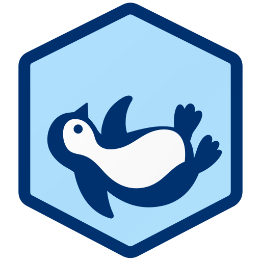

<div align="center">
  
  <h1>Antinomie</h1>
  <p><strong>Follow a program from syscall to evidence.</strong></p>
  <p>A native Linux desktop for malware analysis and reverse engineering,<br>powered by telemetry from the guest kernel.</p>
  <p>
    <a href="#quick-start"><strong>Quick start</strong></a> ·
    <a href="docs/usage.md">User guide</a> ·
    <a href="https://github.com/MoreMorePwn/Antinomie/releases">Releases</a> ·
    <a href="CHANGELOG.md">Changelog</a> ·
    <a href="CONTRIBUTING.md">Contributing</a>
  </p>
  <p>
    <a href="#requirements"></a>
    <a href="docs/implementation.md"></a>
    <a href="LICENSING.md"></a>
  </p>
</div>

Run a sample in a disposable QEMU VM, inspect what it did, and return to the saved
evidence later. Antinomie brings syscall traces, process and file activity,
packets, memory, cores, static analysis and debugging into one workspace.

> [!WARNING]
> **Antinomie runs real malware when you tell it to.** The sample executes inside
> a QEMU guest, and a VM is a boundary, not a guarantee: hypervisor escapes are
> rare but exist, and a sample you give network access can reach whatever that
> route reaches. Use a dedicated machine or at least a user account with nothing
> valuable, keep VM networking disconnected unless you need it, and prefer the
> **None (drop)** or **InetSim** routes. Never run unknown files on a computer you
> cannot afford to rebuild. Antinomie's detections are leads to investigate, not
> a verdict that a file is or is not malicious.

**Status:** this README describes **0.7.0, currently unreleased**, plus the
changes on its preview branch (see [What is new on this branch](#what-is-new-on-this-branch)).
Features and base compatibility can differ from the published builds in
[Releases](https://github.com/MoreMorePwn/Antinomie/releases).

<!-- HERO SCREENSHOT PLACEHOLDER: the repository holds no screenshot of the current
     (0.7.x) interface. Add one under assets/screenshots/ (a trace or Triage view of
     a recorded run) and show it here with an  tag. Do not reuse the 0.1.0 demo
     frame as the hero: it shows an earlier layout. -->

## See it in action

[](assets/demo/antinomie-0.1.0.mp4)

**[Watch the workflow demo →](assets/demo/antinomie-0.1.0.mp4)**
Create a VM, upload and run a sample, inspect its calls, then reopen the recording.
This is the **0.1.0 demo**; it shows an earlier interface, not the current 0.7.0
layout. [Recording details](assets/demo/README.md).

## Why Antinomie

* **The kernel does the watching.** A patched Linux 6.12.94 guest kernel records
  system calls, arguments, return values and captured buffers, with no resident
  tracing agent in the guest. The kernel debugger likewise uses no `ptrace`:
  `TracerPid` stays 0 and the sample's own `PTRACE_TRACEME` succeeds.
* **Evidence stays honest.** Unreadable bytes, unsupported information and
  recording gaps remain visible, and losses are counted instead of hidden.
* **One workspace.** Trace, triage, network, memory, static analysis and a
  debugger share the same saved recording, so you can move from a suspicious
  process to its calls, files and packets without exporting between tools.
* **Reopenable.** Runs are saved. Reopen them from **Run History** after the VM
  is gone.
* **Native and local.** A Rust/egui desktop application on your own machine.
  Analysis tools run in a bubblewrap sandbox; nothing is downloaded until you
  ask for it.

### How it compares

| | Antinomie | `strace` / `ltrace` | Report-oriented sandboxes (for example Cuckoo or CAPE style) |
|---|---|---|---|
| Where tracing runs | Patched guest kernel; no agent, no `ptrace` | `ptrace` in the same system, visible through `TracerPid` | Typically an agent or hooks inside the guest |
| Result | Interactive workspace over saved recordings | Text stream | A generated report |
| Debugger, memory and static analysis in the same place | Yes | No | Varies |
| Guest | Linux x86-64 (BusyBox or Debian) | The system you run on | Varies |

This is a design comparison, not a benchmark. The sandbox column describes the
general approach of that family, not any one product. Antinomie analyzes Linux
x86-64 guests only today.

## What you can investigate

| Workspace | What it gives you |
|---|---|
| **Syscall trace** | Arguments, return values, decoded flags and captured buffers, with filters and links to evidence. |
| **Triage** | Run properties, process trees, file operations (including a per-file history), suspicious activity with an activity graph, HTTP/DNS/TLS metadata and detection results. |
| **Debugger** | Debug on start or attach; inspect threads, registers and memory, use breakpoints and stepping, and open GDB with GEF or pwndbg. |
| **Memory and cores** | Capture memory and process cores, browse mappings and context, and analyze supported memory images with Volatility 3 or MemNixFS. |
| **Static analysis** | File identification, hashes, strings (with FLOSS), UPX unpacking into layers, structures, capabilities (capa), disassembly and Ghidra decompilation. |
| **Network** | Saved PCAPs, TShark packet decoding and Wireshark display filters, with an option to open captures in Wireshark. |
| **Network routes** | Choose per run where a Routed VM's traffic goes: drop, Internet, InetSim fake services, Tor, WireGuard (wireproxy) or a SOCKS5 proxy, without root. |
| **Detection rules** | Manage community and custom YARA, Suricata IDS and Sigma collections and abuse.ch indicator datasets, then scan the evidence their engines support. |
| **VM management** | Read-only base templates, separate VM disks, branching snapshots, resource monitoring, stealth profiles and a stopped-VM disk browser. |

Optional analysis engines are installed through **Tools → Analysis tools** or
provided by the host. See the [tool requirements](docs/usage.md#dependencies-and-analysis-tools)
for each workflow.

### What is new on this branch

Beyond 0.7.0 as described in the [changelog](CHANGELOG.md), this preview branch
adds, among other changes (the history has the full list):

* Per-run **network routes** with Settings > Network routes, and Antinomie's own
  `tor` and `wireproxy` as managed tools.
* The **File activity** view (per-file history with the processes and writes) and
  an activity graph with equal spacing and an overview ruler.
* **MemNixFS** as a second memory backend for Linux dumps.
* abuse.ch **IOC** datasets for offline indicator matching, using abuse.ch's v2
  export endpoints.
* Run History with an analysis tree, and several Triage layout fixes.

## Quick start

### Install a published build

You need a Linux x86-64 computer (glibc 2.39 or newer: Debian 13, Ubuntu 24.04 or
later) with QEMU. On Debian or Ubuntu:

```sh
sudo apt install qemu-system-x86 qemu-utils qemu-system-gui bubblewrap tshark util-linux
```

Download the Linux application archive and `SHA256SUMS` from
[Releases](https://github.com/MoreMorePwn/Antinomie/releases). In the download
directory, verify the archive:

```sh
sha256sum --check SHA256SUMS
```

Extract the verified archive, open a terminal in its extracted folder, and run:

```sh
./install.sh
antinomie
```

This installs the application for your user (no root) and adds its desktop entry.
Prebuilt application installs do not need Rust. Running `./install.sh` from a newer
extracted release updates the executable; application data stays in place.
`./install.sh --uninstall` removes the three installed files and keeps your data.

Other distributions are not documented here: the requirements below name the
programs needed, but only Debian/Ubuntu package names have been checked.

### Offline install: the full pack

Optional analysis tools (Ghidra, capa, FLOSS, Volatility 3, MemNixFS, Tor and
others) are normally downloaded the first time you ask for them. The **full pack**
is a second release asset with the same pinned, SHA-256-verified tools already
inside, for computers that should not download anything. Install the application,
extract the pack and run `./install-full-pack.sh`. See [docs/full-pack.md](docs/full-pack.md).

### Run this branch from source

Install the [host build prerequisites](src/antinomie/monitor/README.md#build-and-run),
then:

```sh
git clone --branch release-0.7.0 https://github.com/MoreMorePwn/Antinomie.git
cd Antinomie
./run.sh
```

`run.sh` rebuilds when its inputs change, then starts the app. Use `./install.sh`
in the checkout to build and install it for your user. Building the host app does
not build a guest kernel or base image.

### Make your first recording

1. Open **Base images** and download, import or build a compatible base.
2. Create a **New VM** from that base, choose its resources, and start it.
3. Upload your sample and launch it. Enable the captures you need for the run;
   network recording requires a connected guest network.
4. Inspect the live views, then reopen the saved run from **Run History**.

**BusyBox** is the small, fast-booting guest for command-line samples.
**Debian Minimal** is console-only Debian 13 with APT and the standard
command-line tools, for samples that need a real Debian userspace without a
desktop. A **Debian desktop** base adds the graphical session. Choose a base
compatible with the application; installing a newer app does not replace an
existing VM's pinned base.

The default data directory is `~/antinomie`. It contains your bases, VM disks and
recordings. See the [user guide](docs/usage.md) for controls, transport settings,
optional tools, desktop execution and layout customization.

## Requirements

- **Host:** Linux x86-64 with a graphical session. WSL2 needs a working graphical
  display; KVM access depends on its virtualization configuration.
- **Virtualization:** QEMU (`qemu-system-x86_64`, `qemu-img`) with its GTK display
  backend. On Debian/Ubuntu: `qemu-system-x86 qemu-utils qemu-system-gui`.
  KVM is strongly recommended; TCG is available without it but has not been
  performance-qualified.
- **Analysis:** bubblewrap for static-analysis isolation; TShark and `prlimit`
  for decoded packets and display filters. Other tools depend on the selected
  analysis. [Full dependency list](docs/usage.md#dependencies-and-analysis-tools).
- **Creating a Debian VM** also needs `virt-customize` (`libguestfs-tools`).

The app checks runtime dependencies at startup. **Tools → App dependencies**
shows missing tools and the affected actions. For a terminal report:

```sh
antinomie --check-dependencies
```

## How observation works

```text
Program and descendants in the guest
                ↓
      Patched Linux guest kernel
                ↓
       Shared-memory transport
                ↓
   Native host app → saved recordings
                ↓
  Trace · Triage · Network · Analysis
```

The kernel records supported activity without a resident userspace tracing
agent. The host manages the VM, retains records and presents the evidence.
Memory and captured data can change while observed; unreadable bytes,
unsupported information and recording gaps must remain visible.

Transport buffering is configurable. **Never drop** waits for host capacity up
to its configured deadline; it can slow the guest and still report drops when
the deadline expires. **Drop new telemetry** favors continued guest progress
and counts what was lost. A detection match is evidence to investigate, not a
maliciousness verdict.

### Limits

* **Stealth is bounded.** A VM stealth profile changes what a guest can read of
  its hardware identity, and the kernel hides its own traces, but some things stay
  visible: the app lists them under "Still visible". `CPUID` and `RDTSC` checks
  leave no system call and are not seen. A sample that reads its own code can
  still find the debugger's `0xCC` breakpoint bytes; hardware breakpoints avoid
  that. Do not assume a sample cannot tell it is being analyzed.
* **Telemetry can be lost.** Known 0.7.0 limitations include telemetry drops under
  heavy stress and intermittently slow reconnect; those follow-ups are scheduled
  for 0.7.1. Loss and partial-recording indicators stay on.
* **Linux x86-64 only.** Guests and the host are x86-64 Linux today.
* **Tools are optional and pinned.** Static-analysis engines, Volatility 3 and
  others run only if installed; downloads are checked against SHA-256 values
  recorded in the source.

See [the changelog](CHANGELOG.md) and [implementation notes](docs/implementation.md).

## Testing and development

The **torture samples** are controlled workload generators: syscall floods,
process trees, file churn, network traffic, async I/O, unusual syscall arguments,
intentional crashes and detection markers. `ant-torture` combines the modules;
individual `ant-*` programs isolate a feature, with light/heavy/extreme levels.

A sample's `PASS` means its action ran. The separate **conformance suite** checks
what Antinomie actually recorded: arguments, results, captured bytes, identities,
loss accounting and trace rendering. A workload completing is not a claim that
the recording is complete or every detection rule matched.

| Start here | Purpose |
|---|---|
| [Contributing](CONTRIBUTING.md) | Kernel patch workflow, builds, checks and version branches. |
| [Host build guide](src/antinomie/monitor/README.md) | Native monitor builds and development commands. |
| [Conformance suite](tests/monitor/conformance/README.md) | Disposable-VM checks and the recording oracle. |
| [Torture sample builder](tests/monitor/build-torture.sh) | Build the combined and individual workload executables. |
| [Implementation contract](docs/implementation.md) | Supported behavior, wire contracts, measurements and limits. |
| [Project layout](docs/project-layout.md) | Durable source, build outputs and artifact retention. |
| [Full pack](docs/full-pack.md) | The offline bundle of every managed tool. |

## Roadmap

These are **planned, not built**, and carry no dates. Nothing here is in 0.7.0 or
on this branch.

* **0.7.1:** fix the two known issues above (telemetry drops under heavy stress,
  slow reconnect).
* **0.8.0 candidates:** rule triggers that react to system-call patterns, TLS
  decryption of captured traffic, guests for architectures other than x86-64, and
  a headless or web front end.

## Contributing

Contributions to the host application, tooling and documentation are welcome and
are accepted under GPL-3.0-only. Read [CONTRIBUTING.md](CONTRIBUTING.md) first: it
covers the kernel patch workflow, the checks, and the `release-X.Y.Z` branch
rule. Run `python3 scripts/check-module-size.py` and `scripts/check-privacy.sh`
before sending changes.

## License

Original host application, tooling and product documentation use
**[GPL-3.0-only](LICENSE) from 0.7.0**. Earlier releases retain their original MIT
terms. Shared kernel headers remain MIT; kernel-derived code, guest components,
third-party tools, rules and assets keep their own licenses.

Read [LICENSING.md](LICENSING.md), [third-party notices](THIRD-PARTY-NOTICES.md)
and the [dependency notice inventory](docs/license-inventory.md) for the scope
and redistribution requirements.

## Acknowledgements

Antinomie builds on the Linux kernel and Debian's kernel sources, QEMU, and the
Rust ecosystem (egui, YARA-X and many crates, listed with their licenses in the
notices). The tools it can run or install belong to their authors: Ghidra,
capa and FLOSS (Mandiant), Detect It Easy, UPX, Volatility 3, MemNixFS, pySigma,
Magika (Google), GEF (bata24), pwndbg, Tor, wireproxy, Wireshark/TShark and
Suricata. Community rules come from their publishers, such as YARA Forge, Emerging
Threats and abuse.ch, under the licenses each carries. Exact versions, hashes and
terms are in [THIRD-PARTY-NOTICES.md](THIRD-PARTY-NOTICES.md).
