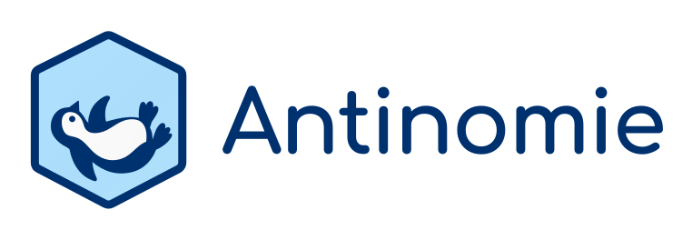
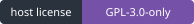
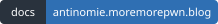
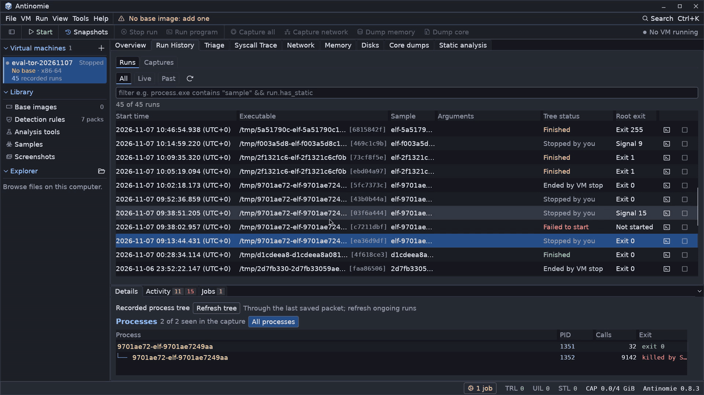
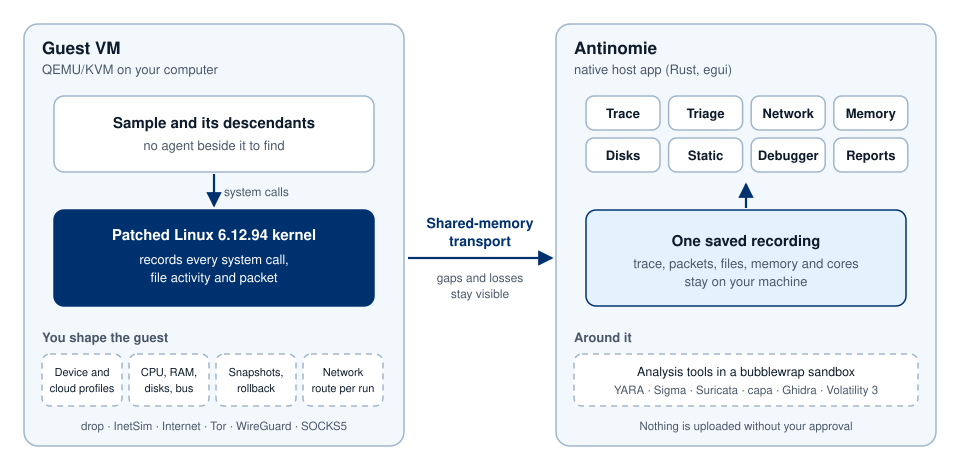
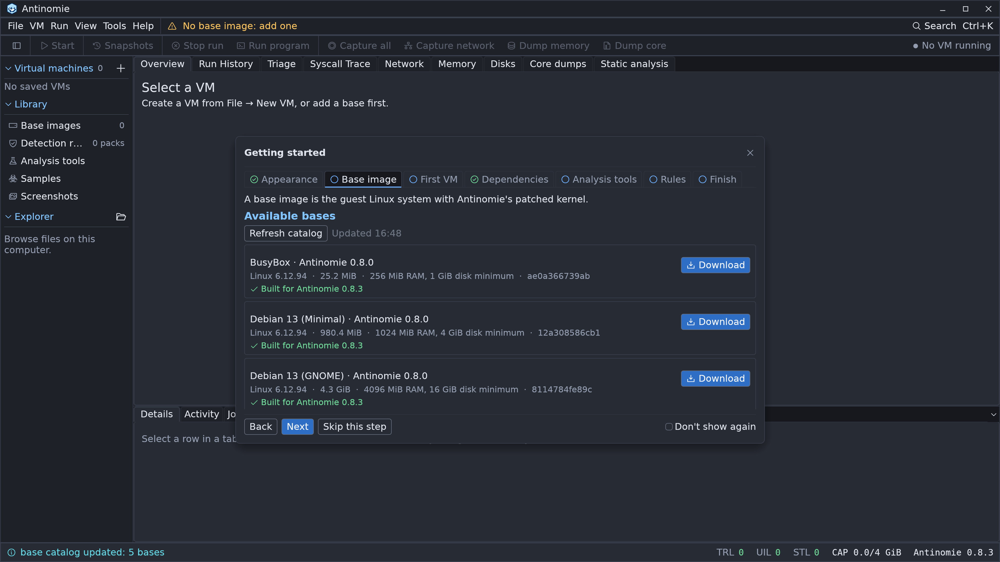

<div align="center">

<picture>
  <source media="(prefers-color-scheme: dark)" srcset="assets/branding/antinomie-logo-dark.svg">
  
</picture>

### A local, kernel-level Linux malware analysis sandbox and workspace.

Run a Linux sample in a disposable VM on your own computer, watch it from inside
the guest kernel, and investigate everything it did in one desktop app.

**Local**: samples, recordings and analysis stay on your machine; nothing is uploaded without your approval.<br>
**Kernel-level**: the guest kernel records every system call, file activity and packet; no monitoring process runs beside the sample.<br>
**Sandbox**: QEMU VMs you control down to the hardware: CPU, memory, disks and their bus, real device and cloud identities, branching snapshots you can reset or roll back to, and a network route per run.<br>
**Workspace**: trace, Triage, network, memory, disks, static analysis, a debugger and all the tools you need in one space.

[**Quick start**](#quick-start) ·
[User guide](docs/usage.md) ·
[Releases](https://github.com/MoreMorePwn/Antinomie/releases) ·
[Changelog](CHANGELOG.md) ·
[Security model](docs/security.md) ·
[Reporting vulnerabilities](SECURITY.md) ·
[Contributing](CONTRIBUTING.md)

[](https://github.com/MoreMorePwn/Antinomie/actions/workflows/ci.yml)
[](https://github.com/MoreMorePwn/Antinomie/releases/latest)
[](LICENSING.md)
[](https://antinomie.moremorepwn.blog/docs/)

<br>



<sub>A real recording: a RotaJakiro sample (SHA-256 <code>d1cdeea8…fd6d</code>) run as root
on Debian 13 Minimal over the Tor route. Every view is the recorded run; no VM is running.</sub>

</div>

> [!WARNING]
> **Antinomie runs real malware when you ask it to.** The sample executes inside
> a QEMU guest. A VM is a strong boundary, not an absolute one: guest-to-host
> escapes are rare but possible.
>
> - Use a dedicated machine, or at least a user account with nothing valuable.
>   Run unknown files only on a computer you can rebuild.
> - Keep VM networking disconnected unless you need it, and prefer the
>   **None (drop)** or **InetSim** routes. A sample you give network access can
>   reach whatever that route reaches; **NAT** reaches the host's own network
>   services and your LAN.
> - Detections are leads to investigate, not a verdict that a file is or is not
>   malicious.
>
> The [security model](docs/security.md) explains the boundaries and what a
> sample can still do.

> [!NOTE]
> This README describes **0.8.3**, a host-only release on the 0.8 line. Download it
> from [Releases](https://github.com/MoreMorePwn/Antinomie/releases); the
> [changelog](CHANGELOG.md) lists every change.

## Highlights

<table>
<tr>
<td width="33%" valign="top">

**A sandbox at kernel level**

Samples run in QEMU VMs on your own machine. A patched guest kernel observes
and controls them, so no monitoring process, ptrace or injected library runs
in the guest's userspace beside the sample. The observer is in the guest kernel:
a sample with root can still look for it, and one that exploits the kernel can
blind it.

</td>
<td width="33%" valign="top">

**One workspace**

Trace, Triage, network, memory and static analysis share one saved recording,
and the debugger sits beside them on the live VM. No exporting between tools.

</td>
<td width="33%" valign="top">

**Native and local**

A Rust and egui desktop app on your own machine. Analysis tools run in a
bubblewrap sandbox. Tools and bases download only when you ask.

</td>
</tr>
<tr>
<td valign="top">

**Triage and detections**

Process tree, files, network and suspicious activity on an activity graph,
mapped to ATT&CK and matched against YARA, Sigma, Suricata and abuse.ch
indicators.

</td>
<td valign="top">

**Report export**

Save a run as HTML, PDF, JSON, MISP or STIX 2.1, with an optional evidence
bundle of its captures and dropped files.

</td>
<td valign="top">

**Every system call**

Decoded arguments, flags, return values and captured buffers, searchable with
a filter language and linked to the evidence they produced.

</td>
</tr>
</table>

## What you can investigate

| Workspace | What it gives you |
|---|---|
| **VM management** | Read-only bases, per-VM disks, branching snapshots, resource monitoring, device profiles and a stopped-VM disk browser. |
| **Triage** | Process trees, per-file history, suspicious activity with an activity graph, HTTP/DNS/TLS metadata and detection results. |
| **Network** | Saved PCAPs, TShark decoding with Wireshark display filters, and per-run routes: drop, Internet, InetSim, Tor, WireGuard or SOCKS5. |
| **Memory and cores** | Capture memory and process cores, browse mappings, and analyze dumps with Volatility 3 or MemNixFS. |
| **Static analysis** | Hashes, strings (FLOSS), UPX unpacking, capa, disassembly and Ghidra decompilation. |
| **Debugger** | Debug on start or attach: threads, registers, memory, breakpoints, stepping, and GDB with GEF or pwndbg. |
| **Syscall trace** | Kernel-recorded system calls with arguments, return values, decoded flags and captured buffers, with filters and links to evidence. |
| **Detection rules** | Community and custom YARA, Suricata and Sigma collections, plus abuse.ch indicator datasets. |
| **Sample library** | Every sample with its hashes, tags, notes, runs and artifacts, and a tamper-evident custody log of everything done to or by it. |
| **File reconstruction** | Replay a file's reads, writes and resizes from the recording to see what each byte is, with the earlier bytes a write replaced and a diff for text files. |
| **Cloud and device identities** | Guests that report the identity strings of a real desktop, laptop or server model or of a cloud VPS instance (Tencent Cloud, Alibaba Cloud, DigitalOcean, Vultr), with a local fake metadata service that hands out canary credentials. Independent, with no affiliation to those companies. |

Optional engines are installed from **Tools → Analysis tools** or provided by
the host. See the [tool requirements](docs/usage.md#dependencies-and-analysis-tools).

## How it works

<picture>
  <source media="(prefers-color-scheme: dark)" srcset="assets/diagrams/how-it-works-dark.svg">
  
</picture>

- The host manages the VM, keeps the records and presents the evidence.
- Memory and captured data can change while observed, so unreadable bytes and
  gaps stay visible.
- Transport buffering is configurable. **Never drop** waits for host capacity up
  to a deadline; **Drop new telemetry** keeps the guest running and counts what
  is lost.

Details are in the [implementation record](docs/implementation.md).

## Quick start

### Install a published build

You need Linux x86-64 with glibc 2.39 or newer (Debian 13, Ubuntu 24.04 or
later). On Debian or Ubuntu, install the host programs. `libguestfs-tools`
gives Antinomie `guestfish`, which writes each Debian VM's account, disk layout
and network card into its disk without root; BusyBox VMs do not need it:

```sh
sudo apt install qemu-system-x86 qemu-utils qemu-system-gui curl libsqlite3-0 bubblewrap tshark util-linux libguestfs-tools
```

Download `antinomie-0.8.3-linux-x86_64.tar.gz` and `SHA256SUMS` from
[Releases](https://github.com/MoreMorePwn/Antinomie/releases) into one folder,
then verify, extract and install for your user (no root):

```sh
sha256sum --check SHA256SUMS
tar -xzf antinomie-0.8.3-linux-x86_64.tar.gz
cd antinomie-0.8.3
./install.sh
antinomie --check-dependencies
antinomie
```

- **No Rust needed.** Prebuilt installs run as they are.
- **Updating:** run `./install.sh` from a newer release. It replaces the
  executable and keeps your data.
- **Uninstalling:** `./install.sh --uninstall` removes the three installed files
  and keeps your data too.
- **Other distributions:** **Tools → App dependencies** names the packages for
  apt, dnf, pacman and zypper. Only Debian and Ubuntu installs are tested.
- **Provenance:** releases from 0.8.0 on carry a build attestation. With the GitHub
  CLI, `gh attestation verify antinomie-X.Y.Z-linux-x86_64.tar.gz --repo
  MoreMorePwn/Antinomie` confirms the archive was built by this repository's
  release workflow from the tagged commit.

<details>
<summary><b>Run from source</b></summary>

<br>

Install the [host build prerequisites](src/antinomie/monitor/README.md#build-and-run), then:

```sh
git clone --branch v0.8.3 https://github.com/MoreMorePwn/Antinomie.git
cd Antinomie
./run.sh
```

`run.sh` rebuilds when its inputs change, then starts the app. `./install.sh` in
the checkout builds and installs it for your user. Building the host app does
not build a guest kernel or base image.

</details>

<details>
<summary><b>Offline install: build your own full pack</b></summary>

<br>

Optional tools (Ghidra, capa, FLOSS, Volatility 3, MemNixFS, Tor and others) are
normally downloaded the first time you ask. For a computer that must not
download anything, **you build a full pack** yourself:

1. On a connected machine, run `scripts/build-full-pack.py`. It fetches the same
   pinned, SHA-256-verified tools from their upstream hosts.
2. Copy the pack over, extract it and run `./install-full-pack.sh`.

**Antinomie does not publish a pack.** See [docs/full-pack.md](docs/full-pack.md).

</details>

### Make your first recording

1. Open **Base images** and download, import or build a compatible base.
2. Create a **New VM** from that base, choose its resources and start it.
3. Upload your sample and launch it. Enable the captures you need; network
   recording requires a connected guest network.
4. Inspect the live views, then reopen the saved run from **Run History**.

<div align="center">

<br>
<sub>First launch on an empty data directory: the Getting started guide.</sub>
</div>

#### Choose a base

| Base | Best for | Notes |
|---|---|---|
| **BusyBox** | Command-line samples | Small and fast to boot. |
| **Debian 13 Minimal (console)** | Samples that need a real Debian userspace without a desktop | APT and the standard command-line tools, no desktop. Needs at least 1024 MiB RAM and 4 GiB disk. |
| **Debian 13 (desktop)** | Samples that need a graphical session | Adds the desktop; programs can run in the guest desktop. |

- Choose a base compatible with the application. Installing a newer app does not
  replace an existing VM's pinned base.
- Your data (bases, VM disks, recordings) lives in `~/antinomie` by default.
- Downloaded bases are GPL-2.0 and Debian software: their corresponding source
  (kernel patch series and configuration, BusyBox and package sources) is in the
  `sources/` folder of the [base bucket](https://huggingface.co/buckets/MoreMorePwn/antinomie-bases/tree/sources).
- The [user guide](docs/usage.md) covers controls, transport settings, desktop
  execution and layouts.

<details>
<summary><b>Download a base by hand (offline machines, mirrors, scripts)</b></summary>

<br>

The app downloads bases for you, but every base is also a plain folder in the
public [base bucket](https://huggingface.co/buckets/MoreMorePwn/antinomie-bases)
on Hugging Face, so you can fetch one yourself:

1. Read the catalog,
   [`index.json`](https://huggingface.co/buckets/MoreMorePwn/antinomie-bases/resolve/index.json):
   each base has a label, its `identity` (a 64-character SHA-256), the
   revision, the minimum app version and its files with their SHA-256.
2. Download every file of the base you want from
   `https://huggingface.co/buckets/MoreMorePwn/antinomie-bases/resolve/bases/<identity>/<file>`
   into one folder (or browse the
   [`bases/` folder](https://huggingface.co/buckets/MoreMorePwn/antinomie-bases/tree/bases)),
   and check each file against the SHA-256 in `index.json`.
3. Install the folder with **Add base → Import base…**, or from a terminal:
   `antinomie --install-base /path/to/folder`. The app recomputes the identity
   and refuses a folder that does not match.

The same bucket holds each base's corresponding source under
[`sources/`](https://huggingface.co/buckets/MoreMorePwn/antinomie-bases/tree/sources).

</details>

<details>
<summary><b>Build your own base</b></summary>

<br>

**Base images → Add base → Build base…** builds BusyBox, Debian 13 Minimal or
Debian 13 desktop from the build kit the app carries. A short wizard asks the
installer questions (hostname; for Debian also language, keyboard, time zone,
software and mirror). **Where** picks how it builds; **Automatic** takes the
first method that can run, in this order:

<details>
<summary>Native (this Linux host)</summary>

<br>

Fastest. BusyBox builds natively on any distribution. The Debian bases also
need `mmdebstrap` and a subordinate UID range for your user. Their kernel
(Debian Minimal's and the desktop's) must carry Debian's own build string and
configuration so that Debian's signed modules load, so it is compiled with
Debian 13's gcc-14 14.2.0-19 and binutils 2.44: the host's where they are
those, else in a rootless Debian 13 toolchain chroot the build sets up once.
Install the tool suite the wizard lists, then choose **Native**.

</details>

<details>
<summary>Podman or Docker (pinned container)</summary>

<br>

Works on any distribution. The first build makes the `antinomie-builder` image
(Debian 13 pinned by digest and package snapshot, the exact toolchain) and
needs the network once; later builds start at once and leave no container
behind. Rootless Podman is preferred: Docker's group gives root-equivalent
access. Kept images are listed in the dialog with a **Remove** button.

</details>

<details>
<summary>QEMU builder (a builder VM)</summary>

<br>

Needs only QEMU and `curl`. The build runs inside a throwaway builder VM, so it
is the slowest but needs nothing else on the host. Automatic falls back to it
when no container image can be fetched.

</details>

<details>
<summary>From the command line</summary>

<br>

`scripts/build-base.py` is the same kit without the app. Write a job file
(`{"format": 1, "profile": "busybox"}`; profiles are `busybox`,
`debian-minimal` and `debian-xfce`), then:

```sh
scripts/build-base.py --job job.json --inputs INPUTS --work WORK --output OUT \
  --kernel-cache kernel.cache --image-cache image.cache --ccache ccache/ \
  --container auto
```

`--kernel-cache`, `--image-cache` and `--ccache` reuse an earlier kernel, root
filesystem and compiler output, so a rebuild after a small change takes minutes.
Import the output folder with **Add base → Import base…**.

</details>

</details>

## Requirements

| Need | Details |
|---|---|
| **Host** | Linux x86-64, glibc 2.39 or newer, with a graphical session. Tested on Debian 13 and Ubuntu 24.04. WSL2 works with an X11 display; KVM access depends on its virtualization setup. |
| **Virtualization** | QEMU 6.0 or newer (`qemu-system-x86_64`, `qemu-img`) with the GTK display backend; Routed networks (cloud profiles' metadata service) need QEMU 7.2. KVM is strongly recommended; TCG works without it but is not performance-qualified. |
| **Downloads** | `curl` for bases, rules and analysis tools. |
| **Analysis** | bubblewrap for isolation; TShark and `prlimit` for packet decoding and filters. Other tools depend on the analysis you choose. |
| **Debian VMs** | `guestfish` (`libguestfs-tools`) to create and reset them. |

The app checks dependencies at startup (**Tools → App dependencies**). From a
terminal: `antinomie --check-dependencies`. The
[full dependency list](docs/usage.md#dependencies-and-analysis-tools) names every tool.

## What's new in 0.8.3

0.8.3 runs the same revision-20 bases as 0.8.0 to 0.8.2; the
[changelog](CHANGELOG.md) has every change, including the fixes.

* **A new Triage Summary:** a header strip with the sample, its packer, the base,
  route and exit; family candidates; **Key findings** (the worst findings, each
  opening its Details); an **Indicators** tree of endpoints, DNS names, URLs and
  files with Copy all and Export; and a **Relationships** graph of processes,
  files, endpoints and injections, with Compact and Full views and Mermaid copy.
* **Suspicious activity in plain words:** coloured tier chips with a hover that
  says why a row has its tier, and descriptions that say what happened and why it
  matters.
* **Process tree and By file:** a Process tree with executable names, pids and
  findings, a click that opens the process, and a **By file** table with one row
  for each file the run touched and its per-file history.
* **Stop run:** ends a run that never exits without stopping the VM, works from
  any page, and records "Stopped by you at 5 min 9 s".
* **Dumps when suspicious activity is seen:** a run can take a memory dump or a
  core the moment a rule of the tier you chose matches. Every core and memory dump
  says which run it belongs to and why it was taken, with **Run** columns and a
  **This run only** filter.
* **IDS and Sigma after every run:** a finished run is scanned as soon as its
  recording is saved, or says "Not scanned" and why.
* **Family candidates:** families come from rules that name one on purpose, and
  vendor names are never a family.
* **The VM's screen in the app:** a **VM screen** tab with click-to-type, Fit and
  1:1, Ctrl+Alt+Del and Screenshot, and a **Screenshots** gallery in the Library.
* **Keyboard shortcuts you can change:** **Settings > Keyboard** has one row for
  each action, refuses a key another action holds, and the defaults suit a 60 %
  keyboard.
* **A foldable sidebar and panes:** the sidebar folds to a rail of icons
  (**Ctrl+B**), Details, Activity and Jobs fold to their tab strip (**Ctrl+J**),
  and the toolbar has one Start/Stop button.
* **abuse.ch YARAhub:** about 1,700 community YARA rules as a rule pack beside
  YARA-Forge and Elastic.
* **Reports:** the run report opens with **At a glance** and a key-findings table,
  links every process, file, endpoint and rule, has a contents list and a
  bookmark tree in the PDF, and comes as a **Markdown** report too; the JSON
  report is schema 2.
* **Samples and static analysis:** the sample page shows Triage's family, a failed
  capa reads as a sentence, and every filter box has a cross that clears it.

## What's new in 0.8.2

0.8.2 runs the same revision-20 bases as 0.8.0 and 0.8.1; the
[changelog](CHANGELOG.md) has every change, including the fixes.

* **Find your way:** a command palette (**Ctrl+K**) that opens every window and
  action, keyboard shortcuts for the work-area tabs and common actions (press
  **?** for the list), a **Jobs** window with progress and Stop for long work, a
  notification when a run finishes, run states in one colour scheme, an
  **Appearance** step in Getting started and a **time zone** setting that every
  view and report follows.
* **Memory dumps and process cores:** a **Content** view (hex and text, go to
  offset or address) with on-demand **Strings** and **Regex** search, and core
  mappings named like `/proc/PID/maps` (`[stack]`, `[heap]`, `[vdso]`).
* **Syscall Trace:** captured record arrays (directory entries, poll fds, control
  messages, BPF programs and more) as expandable trees with short summaries in the
  table, and **Decode all captured** for records past the preview.
* **Samples and indicators:** an **IOCs** tab in the sample window with every
  indicator across a sample's runs, filters and CSV, JSON, MISP and STIX 2.1
  export; the Triage IOC tab shows how many indicators matched a dataset.
* **ATT&CK:** techniques coloured by tactic and an expandable list that leads to
  the rules and evidence behind each one.
* **Recordings:** when the recording quota is nearly full, Antinomie keeps the
  calls the suspicious-activity rules use and counts the rest instead of stopping;
  a run waits for a systemd guest to finish booting before it starts; reports say
  why a process ended on a signal.
* **Network and VMs:** offline IP geolocation for TShark (an optional DB-IP Lite
  download or your own MaxMind GeoLite2 folder), and a snapshot diagram on the VM
  Overview.

## What's new in 0.8.1

0.8.1 is a fix release for the 0.8.0 line; the [changelog](CHANGELOG.md) has the
full list.

* **Hosts without KVM:** a VM on the default accelerator starts with TCG and a
  warning instead of failing, every start wait scales for slow TCG boots, and
  missing-KVM messages offer "Use TCG".
* **Downloads:** a cancelled download resumes when it can and starts again when
  it cannot, and says which.
* **Notes** on packets, captures, memory and disk dumps, process cores and static
  analysis rows, with chips that jump to them; notes can be edited and deleted
  wherever they are shown.
* **Triage:** tasks read "PID · TID", filter chips show their counts, failed
  attempts are shown by default, the run's state and elapsed time sit beside the
  network route, other views' notes stay out of the Summary, and the IOC details
  open in the Details window.
* **Sample window:** edit a sample's name and description, a click on a row's
  text opens it, the 100 longest strings and every regex match scroll, and the
  static analysis summary explains each check.
* **Layout:** every table fits its window, the toolbar moves buttons into a menu
  when narrow, and the dependencies and export windows stay inside the screen.
* **Reliability:** a clear error screen when the app cannot start its engine, no
  false legacy-migration warning on a fresh install, file reconstruction keeps up
  to 16 MiB per file (a setting), and `--version` names the commit it was built
  from.

## What's in 0.8.0

Highlights of 0.8.0 on top of 0.7.1; the [changelog](CHANGELOG.md) has the full
list.

<details>
<summary><b>Show the 0.8.0 changes</b></summary>

<br>

* **Guest contract revision 20** with rebuilt bases; Debian Minimal and the
  Debian desktop are assembled from pinned Debian userland.
* **Network routes:** an egress abuse filter on live routes, routed captures and
  routes that survive snapshots and reconnects.
* **Static analysis:** Ghidra disassembly and programs up to 128 MiB.
* **Report export:** HTML, PDF, JSON, MISP and STIX 2.1, with an optional
  evidence bundle.
* **Device profiles:** whole machine identities, including cloud VPS profiles
  with a canary metadata service.
* **Samples:** a library with a custody log, a window per sample and file
  reconstruction.
* **Interface:** two more rounds of fixes, larger default text, and a per-run
  count of lost telemetry.
* **Security:** zip 9.2, wasmtime 48.0.8 and one strict check for every
  untrusted zip.

</details>

## Roadmap

Planned and undated:

- **Headless mode**
- **Docker-based web interface and API**
- **Auto mode**: a sample in, a report out
- **arm64** and **MIPS** guests
- **TLS decryption**
- **In-memory unpacking detection**: catch and save code a sample decrypts or
  unpacks in memory
- **OpenWrt** and **Ubuntu** bases

## Documentation

| Read | For |
|---|---|
| [User guide](docs/usage.md) | Bases, VMs, runs, routes and reading results. |
| [Triage report](docs/triage-report.md) | Export formats, evidence bundle and the JSON schema. |
| [Security model](docs/security.md) | Trust boundaries, network modes, sensitive data and safe use. |
| [Security policy](SECURITY.md) | Supported versions and how to report a vulnerability privately. |
| [Implementation record](docs/implementation.md) | Implemented behavior, wire contracts, measurements and limits, by release. |
| [Host build guide](src/antinomie/monitor/README.md) | Native monitor builds and development commands. |
| [Contributing](CONTRIBUTING.md) | Host builds, checks, pull requests, the kernel patch workflow and version branches. |
| [Conformance suite](tests/monitor/conformance/README.md) | Disposable-VM checks and the recording oracle. |
| [Project layout](docs/project-layout.md) | Durable source, build outputs and artifact retention. |
| [Full pack](docs/full-pack.md) | Build your own offline bundle of every managed tool. |

<details>
<summary><b>Testing: workload samples and the conformance suite</b></summary>

<br>

- The **workload test samples** are controlled generators of system-call load,
  process trees, file activity, network traffic, async I/O, unusual arguments,
  crash handling and detection markers. `ant-workload` combines the modules;
  individual `ant-*` programs isolate one feature at several load levels. A
  sample's `PASS` means its action ran.
- The separate **conformance suite** checks what Antinomie recorded: arguments,
  results, captured bytes, identities, loss accounting and trace rendering.

Build the samples with [`build-workload.sh`](tests/monitor/build-workload.sh).

</details>

## Contributing

Contributions to the host application, tooling and documentation are welcome and
accepted under GPL-3.0-only.

- Read [CONTRIBUTING.md](CONTRIBUTING.md) first: host builds, the checks to run,
  pull requests, the kernel patch workflow and the `release-X.Y.Z` branch rule.
- Report bugs with the issue forms.
- Report security problems privately as described in [SECURITY.md](SECURITY.md).
- Never attach live malware or real credentials to a public issue.

## Responsible use

Antinomie is for analyzing software you are permitted to handle, on systems you
control.

- You are responsible for what your samples do, including any traffic they send
  through a route you enable (Internet, Tor, WireGuard or SOCKS5) and any data
  they reach.
- Device profiles show the identity strings of real hardware makers and cloud
  providers only to the guest of your analysis VM. They imply no affiliation
  with those companies; see [Trademarks](#trademarks).

## License

Original host application, tooling and product documentation use
**[GPL-3.0-only](LICENSE) from 0.7.0**. Earlier releases keep their original MIT
terms. Shared kernel headers remain MIT; kernel-derived code, guest components,
third-party tools, rules and assets keep their own licenses.

Read [LICENSING.md](LICENSING.md), the [third-party notices](THIRD-PARTY-NOTICES.md)
and the [dependency notice inventory](docs/license-inventory.md) for the scope and
redistribution requirements.

## Acknowledgements

Antinomie builds on the work of others. The tools it can run or install belong
to their authors.

| Area | Projects |
|---|---|
| Guest and VM | The Linux kernel and Debian's kernel sources, QEMU |
| Desktop app | The Rust ecosystem: egui, YARA-X and many crates, listed with their licenses in the notices |
| Analysis | Ghidra, capa and FLOSS (Mandiant), Detect It Easy, UPX, Volatility 3, MemNixFS, pySigma, Magika (Google) |
| Debugging | GEF (bata24), pwndbg |
| Network | Tor, wireproxy, Wireshark/TShark, Suricata |
| Rules | Community rules from their publishers, such as YARA Forge, Emerging Threats and abuse.ch, under the licenses each carries |

Exact versions, hashes and terms are in [THIRD-PARTY-NOTICES.md](THIRD-PARTY-NOTICES.md).

## Trademarks

Names of hardware makers and cloud providers (Dell, OptiPlex, Latitude, Vostro,
PowerEdge, HP, EliteDesk, ProDesk, ProBook, HP 250, Lenovo, ThinkCentre,
ThinkPad, ThinkSystem, Supermicro, AMI, Intel, AMD, Realtek, Broadcom, Samsung,
Micron, SK hynix, Kingston, Crucial, Western Digital, Seagate, Toshiba, Tencent
Cloud, Alibaba Cloud, DigitalOcean, Vultr, Hetzner, Linode, Amazon EC2, Google
Compute Engine, Microsoft Azure, OVHcloud, Oracle Cloud, OpenStack, Ubuntu,
Debian, Wireshark, Tor, VirusTotal and others) belong to their owners.
Antinomie uses them only to say which real machine or cloud instance a device
profile imitates, or which provider the host runs on. It is not affiliated
with, endorsed by, sponsored by or certified by any of them, and a name does not
mean the vendor tested or supports the software.

A device profile is an independent imitation of the identity strings such a
machine or instance reports: product and BIOS names, versions and dates, board
and chassis types, ACPI OEM IDs, MAC prefixes and network settings, taken from public hardware
reports. It contains no logos, no firmware or BIOS code, no ACPI tables dumped
from a unit, no real serial numbers, no provider software and no provider
credentials. A cloud profile's agent files are empty stubs.

- The simulated metadata service of a cloud profile is generated by Antinomie on
  your computer. It answers only the guest of the VM, over an in-process
  connection, and never contacts a provider.
- The credentials it hands out are canaries: random values made new for each
  run, in the shape of the provider's credentials. The provider never issued
  them, so none is expected to accept them.
- Profiles are for analysis VMs on your own computer. They do not change how any
  other computer looks to a provider or a third party, and are not a way to
  present a machine to a provider as something it is not.
