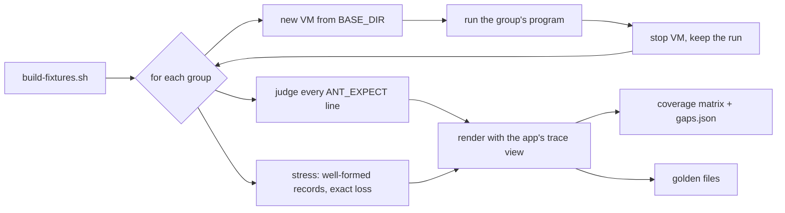

# Guest conformance suite

The suite boots disposable BusyBox VMs, runs programs that say exactly what
they did, and checks what Antinomie recorded and shows against that. Part 1
covers the **syscall trace log**: every native x86-64 system call slot, its
arguments, results, captured data, async records, the Syscall Trace view's
rendering, and the loss accounting under load.

```sh
cd src/antinomie/monitor
cargo run --release --locked -j 2 -p antinomie-monitor-core --example conformance -- \
    trace BASE_DIR OUT_DIR [--bless] [--groups user,root,…] [--recheck] [--no-render] [--no-build]
```

| Argument | Meaning |
|---|---|
| `BASE_DIR` | A BusyBox base bundle (`bundle.json`, kernel, initrd, `base.qcow2`) with guest series 0001 onwards, or a Debian Minimal base: its VMs get the base's minimum RAM and disk and a throwaway `conformance` account (UID 1000) and count as booted at the console login prompt (its `/tmp` is on the root filesystem, as BusyBox's is) |
| `OUT_DIR` | Where fixtures, recordings and reports go; reruns replace a group's folder |
| `--groups` | Only these fixture groups (default: all) |
| `--recheck` | Check the runs already in `OUT_DIR` without booting anything |
| `--bless` | Rewrite the golden files from this run |
| `--no-render` | Skip the rendering check (it builds and runs a monitor-ui test) |
| `--no-build` | Use the fixtures already in `OUT_DIR/bin` |

The exit status is 0 only when every group, the coverage matrix and the golden
files pass. Everything the app writes (data folder, settings, caches) stays
under `OUT_DIR`; the app's own data and the user's VMs are never touched.

## What one run does



1. `build-fixtures.sh OUT_DIR/bin` builds the static fixtures: `trace-fixture`
   (`trace/fixture/*.c`) and `ant-workload` (`../workload`).
2. Each group gets a new VM (4 vCPUs, 2 GiB, waits until the host has 3.5 GiB
   free), uploads its program, runs it until the guest reports the whole process
   tree ended, reads the recorder's counters (`STATS`), stops the VM and deletes
   its disk overlay. The recording, `group-run.json` (health, counters, and how
   long boot, run and Stop took) and the guest console (`serial.log`) stay in
   `OUT_DIR/groups/GROUP/`.
3. Oracle groups are judged call by call (`examples/conformance/judge.rs`),
   stress groups record by record (`stress.rs`), attribution groups by their
   run status (`attribution.rs`); all check the run's health and accounting
   (`trace.rs`).
4. `render.rs` runs the opt-in test `conformance_trace_render` of the monitor-ui
   crate, which shows every recorded call through the Syscall Trace view's own
   code (table cells, Info column, argument rows, field previews and one frame of
   the inspector) and writes `OUT_DIR/render/GROUP.jsonl`.
5. `matrix.rs` writes `OUT_DIR/trace-matrix.json` and `trace-matrix.txt`;
   `golden.rs` compares with `trace/golden/GROUP.txt`. Golden lines name the
   root disk (`<root-dev>`: BusyBox's whole disk, a Debian Minimal partition)
   and the work directory's device number (`<work-dev>`) by role, as the
   fixture reports them (`ANT_GROUP` `rootdev`, `workdev`), so one golden
   serves both bases.

Reports: `OUT_DIR/trace/GROUP.json` (every case, problem, gap, the accounting and
throughput), the matrix, `render/`, and on a golden mismatch
`OUT_DIR/golden-GROUP.txt` (the new text).

## Groups (part 1)

| Group | Program | User | What it covers |
|---|---|---|---|
| `user` | `trace-fixture user` | 1000 | Every user area: files, file positions and in-kernel copies, writes through shared file mappings, paths, xattr/splice, events, network (loopback, AF_UNIX), memory, process, identity, signals, time, futex, SysV/POSIX IPC, keys, AIO, io_uring and the refused administrative calls |
| `root` | `trace-fixture root` | 0 | The privileged success variants, each made harmless (private namespaces, children, values set to what they were) |
| `threads` | `trace-fixture threads` | 1000 | 8 pinned threads × 200 calls and 32 short-lived processes: identity and ordering under concurrency |
| `ring-private`, `ring-shared`, `ring-sqpoll` | `trace-fixture ring-…` | 1000 | Who wrote an io_uring entry, one run each (`trace/fixture/attribution.c`): a ring one process maps is complete (ASYNC_COMPLETE, every request `async.flags` bit 3, no note); a ring a forked child still maps and an SQPOLL ring are OBSERVATION_INCOMPLETE (bit 1) with the attribution note, never loss |
| `stress-light`, `stress-heavy`, `stress-extreme` | `ant-workload --level L --only syscall-load,object-capture,process-tree,file-churn,async-io,decoder-variants,argv-env,timing` | 0 | Load on every CPU, large objects, thousands of processes, async I/O; default (never-drop) transport |
| `stress-lossy` | the same at `heavy` | 0 | A 256 KiB ring that drops: every lost record must be counted |
| `stress-contended` | the same at `heavy` | 0 | A 256 KiB ring that never drops, with a 100 ms send wait: senders find their ring full all the time and compete for the room the host frees. A measurement: a sender still drops when the host reads nothing from its ring for the whole wait (a busy machine), so `vm-regress.py` judges its drops by attribution instead of by count: every drop must fall in a gap in the host's telemetry reads or in a spell where a ring stayed full while the host kept reading, at least as long as the send wait (the numbers are reported as a measurement); a drop with neither cause, or any other problem, fails it |

## The oracle

Every call a fixture makes goes through `CALL()` (`trace/fixture/oracle.h`):
the raw system call with all six registers set, timed with `CLOCK_MONOTONIC`
(the clock the recorder stamps). The fixture then describes the call and
`DONE()` prints one line:

```text
ANT_EXPECT {"seq":12,"label":"openat.cwd","nr":257,"name":"openat","pid":116,"tid":116,
  "t0":…,"t1":…,"args":["0xffffffffffffff9c","0x4b2f10","0xc1","0x1a0","0","0"],
  "ret":3,"want":0,"ok":true,"volatile":false,
  "data":[{"p":"in","arg":1,"kind":"str","hex":"696f2d6174"}],
  "status":[],"async":[],"file":{"kind":"OPEN","major":254,"minor":0,"ino":12,"nlink":1}}
```

| Member | Meaning |
|---|---|
| `label` | Unique case name, `<syscall>.<variant>` |
| `t0`, `t1` | The call's time window; the recorded Entry (and Exit) must fall in it |
| `args` | The six registers passed; the recorded Entry must have them |
| `ret` | The raw result the program got (negative errno) |
| `want`, `ok` | What the case meant to exercise (0 = success, an errno, -1 = either) and whether it did; a case that did not is a fixture failure |
| `data` | Bytes behind an argument at entry (`in`), exit (`out`) or either (`any`), by argument or exact recorded key; `str` compares without terminators, `any` only requires a complete capture |
| `status` | Capture statuses the case triggers on purpose (COPY_FAULT, NOT_RESIDENT, INVALID_EXTENT, …); the recording must have exactly these |
| `recapture` | Inputs the recorder could not read at entry and captured later (contract section 22): key (a trailing `*` covers every key it starts with) and mark, `at exit` or `kernel copy`; the recording must have exactly these |
| `file` | The file identity (`lifecycle.file_id`) an open, rename, link or unlink must publish |
| `pos`, `nopos` | Where a read or write of a seekable file began and its length (`file.position`, revision 18), or that the call has no position (a pipe) |
| `before` | The label of a write the file system applied after this one (two processes wrote the same range at once and the file's bytes show which was last): this write's `file.position` write order must be the lower |
| `copy` | What an in-kernel copy or allocation moved (`file.copy`): kind, length, fallocate mode, the bytes carried, and each end's device, inode, mode and offset (and the destination's size) as the program saw them with fstat |
| `mapped` | Pages of a file written through a shared mapping that the call wrote back or dropped dirty (`lifecycle.file_mapped`): cause (`WRITEBACK`, `UNMAP`), the file's device and inode, offset, length, bytes copied, why the rest is missing (`BUDGET`) and an FNV-1a hash of the copied bytes; the call must carry exactly these records, each with a write order |
| `hash` | The guest's hash of a written file at its last close, which the call carries: it must be the SHA-256 of the bytes another case (`content`, its output buffer) read back from the file |
| `async` | io_uring/AIO requests the call submitted: their records, result and payload bytes |
| `volatile` | Values that differ between runs; golden files mask them |
| `implicit`, `noreturn` | Calls the program did not make itself (rt_sigreturn, restart_syscall) or that end the task (exit, a fatal signal) |
| `why` | The reason for the case's shape, required for dangerous calls and environment-dependent results |

Other lines: `ANT_ROLE` (a process or thread role), `ANT_GROUP` (area and work
directory markers), `ANT_FIXTURE_FAIL` and `ANT_DONE {"failures":N}`.

## What fails the suite

* a fixture case that did not do what it meant, a malformed oracle line or no
  `ANT_DONE` with zero failures;
* a described call with no recorded invocation, other arguments, another
  result, other captured bytes, an undeclared non-complete capture status, a
  missing file identity or a wrong async record;
* any warning or error of any recorded call, described or not (missing
  phases, incomplete captures, recorder loss marks), unless the capture
  contract explains it and `trace/gaps.json` lists it under `undescribed`;
* a raw packet the parser rejects, a trace page diagnostic, a run that did not
  end `Finished` with exit 0, a recording error, a backend error, transport,
  parser, storage or note losses outside `stress-lossy`, any run note or
  OBSERVATION_INCOMPLETE in an oracle group (its rings are its own), async
  observation losses;
* an attribution group whose run flags, notes or requests' producer bits are
  not the ones its ring calls for;
* accounting that does not add up: packets saved = recorder attempted − failed
  = persisted; events saved = events attempted when nothing was lost; every
  call that shows loss covered by a failed send;
* a rendering fallback where the view should show a value (an argument whose
  data was captured shown as an address, a generic argument or syscall name,
  a captured field shown as uncaptured), unknown flag bits or selector names on
  a call that succeeded unless accepted, a panic in the inspector;
* a slot of the native table that no case exercised without a reason, a gap
  (`no_decoder`, `not_captured`, `render`) not listed in `trace/gaps.json`;
* a golden file that differs.

`trace/gaps.json` is the explicit list of what the recorder or the view cannot
do yet, each entry with its reason. A gap that disappears should be removed
from the list.

## Writing cases

Read `trace/fixture/oracle.h` and follow `trace/fixture/file_io.c`. Everything
happens in the private `work_dir`, offline, under a 240 s alarm. Dangerous
calls are refused as UID 1000 (`system.c`) or made harmless as root
(`root.c`); each says why. Children use `in_child()` or `ora_child()`, and
their case numbers never collide. `ora_make_resident()` prefaults the image so
the recorder's no-fault copies see the program's literals; the residency cases
(`recapture.c`) fork with `ora_child_cold()` instead and pass literals from a
64 KiB block nothing else reads.

## Adding a part

A part is a subject of the suite (file lifecycle, process tree, network,
Suspicious activity). Implement `Part` in `examples/conformance/`: name its
groups (`Group`: a `VmPlan` and whether it is an oracle or a load group) and
check their runs; register it in `parts()`. The VM driver, the oracle line
parser, the recording readers, the rendering runner and the golden-file
machinery are shared. Fixtures and goldens of a part live in
`tests/monitor/conformance/<part>/`.
